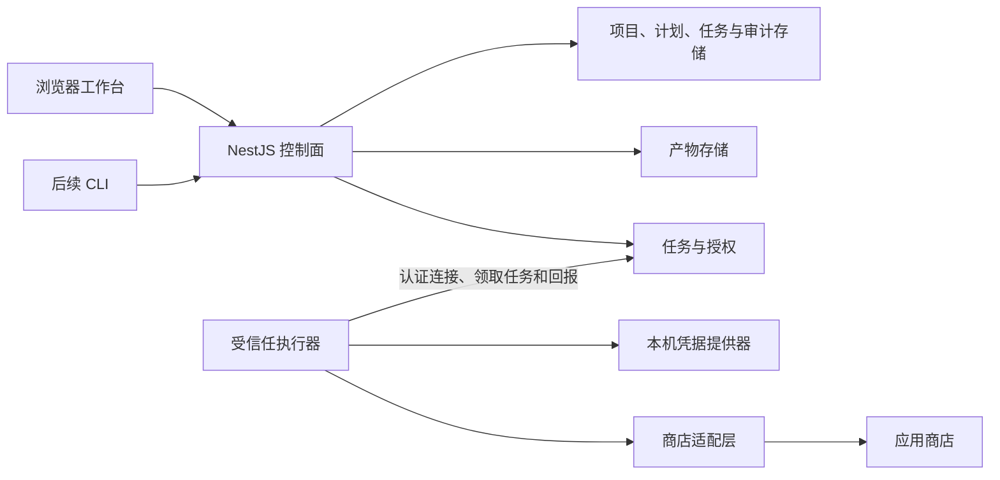

# 产品架构设计

## 部署形态

图中在线任务存储、远程执行器认证和远端发布是目标架构。当前已实现 Ant Design Web、NestJS 项目／应用／商店绑定／产物／只读预检／发布计划 API、本地文件存储、商店账号页面向导与维护 CLI，以及独立配置、产物检查和只读预检本机进程，其余逐期落地。

项目继续使用已有 `projects.json`；应用与绑定共同保存在带 `schemaVersion: 1` 的 `applications.json`，通过同一队列和原子替换保护身份、商店目标唯一性及绑定 revision。新文件的引入不迁移旧项目文件；不支持多个服务实例共享写入。绑定仅包含公开凭据引用，不内嵌可过期的预检结论。

产物采用 `artifacts/{UUID}/record.json` 与固定内部字节文件，原始文件名只用于展示。API 负责流式接收、计数、摘要、配额和状态持久化，接收完成后返回 202；`runner-local` 在独立 Node 子进程重新核对 inspect-only 动作、任务身份、目标、路径与字节摘要，再调用 SDK。私有协议含路径，仅在可信父子进程间使用，不能放进 `packages/contracts` 或接受浏览器直接指定。结果使用随机 nonce 关联并经过安全投影；停止／重启不重跑未完成检查。该本机信任模型不是远程执行器配对认证。

凭据由本机配置服务或维护 CLI 写入本产品 Keychain service 和独立 Vault。API 仅调用 worker 的目录与预检端口，不加载 SDK、不解析秘密；带版本的私有协议只接受 catalog／preflight，预检在解析凭据前核对产物，网络边界仅允许华为鉴权／应用查询、Apple 应用查询及小米固定 /dev/query 查询。禁止重定向、自动重试及商店写动作。API 先保存 running 再返回 202，最终安全事实写入 `preflights.json`；中断恢复为无法验证。查询重算五分钟有效期及绑定、Profile、产物变化，并为历史通过结果重新核对磁盘字节；不在 GET 中重跑商店查询。

## 各层职责

- Web：用户操作与公开数据展示，不读取服务器或执行器路径；局部商店账号向导可临时持有用户输入并直接提交独立本机配置进程，不读取已保存秘密。
- NestJS 控制面：身份、租户授权、项目／应用、渠道配置引用、计划、任务、记录和查询；长时间上传不占用 HTTP 请求处理过程。
- 领域包：项目标识、归属、产物与动作合同、执行规则，不依赖 NestJS 或供应商 SDK。
- 存储实现：当前单进程本地文件；线上使用数据库的租户键、事务与唯一约束，不把文件级互斥冒充多实例能力。
- 执行器：检查产物与本机能力、取得已批准任务、解析凭据、执行和回报；本地和在线环境采用相同任务语义。
- 商店 Adapter：独立封装 SDK 与补充接口，SDK 不直接穿透到浏览器合同。

## 本地与在线的区别

本地版把 Web、API 与未来本机执行器部署在同一台设备，提供便利的个人工作空间。在线版将 Web/API 放到服务器；本地文件需要显式上传至产物存储，或通过已配对执行器选择并登记。浏览器不能把一个用户文件路径交给云服务器直接读取。

Apple 上传工具及 Keychain 等运行约束归属执行器。Linux 云服务器不被假定天然具备 macOS 认证和工具链能力。公网控制台连接执行器时采用经认证的出站连接或拉取协议，不让公网网页默认直连 localhost。

## 计划与执行合同

计划绑定 workspace、project、application、商店目标、产物摘要、动作、更新说明与配置指纹；授权另行绑定具体计划和有效范围。执行器领取任务后再次核对上下文和摘要，才可解析秘密并发起远端操作。

每次执行记录唯一 attempt ID，远端结果不明时进入待核对，不自动重复送审。网络或进程中断不能被描述为远端撤回。SDK 回执、执行事实和远端状态观察分别存储。

## 在线隔离要求

用户身份来自服务端认证，租户范围由受信任上下文获得，所有存储查询和任务授权同时带租户归属。产物访问、下载地址、执行器任务和回执均需相同范围校验；浏览器提供 workspaceId 不能构成授权。

当前本地固定 local workspace 和存储测试只说明代码具备隔离接口，不代表组织认证、RBAC、执行器配对或多租户生产能力已完成。

## NestJS 选择

后端使用 NestJS Module／Controller／Provider 组织功能，Fastify adapter 处理 HTTP。当前显式注入 ProjectStore，后续可替换为数据库实现，测试通过相同领域入口验证；浏览器和 domain 不依赖 NestJS。

架构随实际功能增加模块，首轮不引入 Redis、数据库 ORM、消息总线或自动化审批等尚未使用的运行依赖。

## 页面内账号配置

`runner-local` 宿主通过固定入口启动独立配置进程，使用带版本及请求 ID 的私有 IPC 交换启动参数、会话控制和安全结果。配置进程在随机回环端口直接接收浏览器材料；NestJS 不代理材料 HTTP。工作台使用精确来源、Host、短期随机能力、固定渠道及单操作关联；能力只存向导内存，材料不进入公共 contracts、通用 API Client、URL、日志或页面缓存。

配置服务复用 SDK 的安全存储，另用 `credential-accounts.json` 保存名称和固定 reference 的操作意图。材料保存与标签文件没有跨文件事务，SDK 故障或重启无法核对时标记待核对，不自动重发；目录和预检禁止使用待核对档案。旧 CLI 档案无标签时使用原引用，无需重录秘密。元数据可读不代表 Keychain 解密或商店鉴权通过。

账号维护通过安全元数据动作交给同一配置 worker，名称编辑不改原引用；重新录入使用绑定原引用和管理版本的短期会话，实际保存前再次比对版本。删除在控制面的绑定写队列内确认无引用，worker 先隔离、再清理材料、最后移除标签。未完成或失败保留待核对。管理版本与预检材料目录版本独立，所有材料替换仍使旧预检失效。

provider 使用 macOS 系统 JXA／Security 桥接代替 SDK 的交互密码管道，材料只经私有 stdin／stdout，写后完整读回比较；继续使用相同 service 和 SDK Vault 格式。目录读取仍不解密；重新核对是用户显式触发的本机读取，不执行商店请求。共享 Vault 主密钥不随单账号删除。

## 本地发布计划与确认

P1-4 将应用、绑定、产物与通过预检的公开事实固定为不可变快照，更新说明与配置分别计算摘要，整份快照形成计划摘要。`release-plans.json` 同队列保护冻结请求去重、确认与取消，快照与授权同文件原子替换。未知版本或指纹损坏拒绝覆盖。

写接口要求精确本机来源和专用请求头，确认同时要求预期摘要与明确同意。local_once 授权仅固定计划内容、动作和有效期限，不作为可复制的执行能力；有效期不超过原预检期限。查询与确认重算目录、绑定、产物记录和实际字节，取消或失效的确认不得使用。此保护适用于单进程本地版，不是在线认证或跨文件事务。

本机执行接口将一次性消费与 attempt 同文件原子提交，版本 1／2／3／4／5／6／7／8 计划文件兼容升级为版本 9。固定 worker 通过私有 stdin 接收计划与目录，nonce 关联 IPC；API 不加载 SDK。worker 重算指纹、复核独立产物副本及账号目录版本，并只读查询商店目标。上传前要求 API 再核对依赖、持久化远端许可后才开始。执行中进程退出或回执丢失均按许可事实恢复为中断或待核对，重启不重放。

SDK 回执留在 worker 内存，产品仅记录固定状态与时间。华为固定 draft、单次上传且不送审。待核对目标未记录人工结论前禁止新计划再次上传；核对结论只附加到原始未知终态，未保存且无处理中任务时可用新计划，已有草稿时仍阻止相同摘要产物重复上传。Apple SDK 0.3.0 的上传工具调用不能消费现有 API Key，因此消费前明确拒绝，保留确认；真实渠道验收仍未完成。

## 执行诊断与人工核对

固定 worker 仅回传白名单诊断码，API 保存安全原因与建议；不接收供应商正文、秘密或路径。历史没有诊断码时保持缺失，不能事后推测。写入许可后的异常依旧待核对。小米上传将请求超时、中止、网络异常、HTTP 非成功、回执格式异常和业务非成功映射为固定码，经私有 IPC 保留到原执行回执；控制面不再统一覆盖为 remote_unknown。许可前原因不得冒充上传原因，未细分的异常仍保持宽泛原因，不保存供应商正文或原始异常。

人工核对要求精确本机来源、完整归属、计划摘要和版本一致、明确同意。结论附加到已结束的未知结果，不修改原始回执；同结论幂等，相反结论冲突。核对及新执行串行处理，解除阻塞不触发任务。人工声明与自动商店核验有明确区别，用户仍须确保后台没有处理中任务。

## 自动准备与一次确认

准备请求以当前绑定版本、产物摘要和说明形成公开意图。系统先持久化 preparation，再后台运行只读预检并冻结未授权快照；HTTP 返回 202，刷新只读取进度。进行中重启标为中断，不重放。预检与准备关联之间中断时可能保留无授权检查／快照，但不能派发商店写入。

发布页在摘要内只要求一次明确执行确认。confirm-and-execute 在同一存储队列内检查目标、摘要、期限、单槽及待核对阻塞，再原子产生／消费授权和执行尝试；失败不保存孤立确认。旧确认只复用不续期，原历史接口保留兼容。存储版本 4 增加 preparations，读取兼容版本 1／2／3。当前开放华为草稿及小米／OPPO／vivo／魅族／荣耀普通应用更新，Apple 暂缓。小米增加公开图标、商店名称及隐私政策，计划文件升级为版本 6；旧快照保持原指纹。

## 小米已有应用更新

小米以包名定位，绑定目标等于 Android 身份；账号材料与审核测试登录资料仅在独立配置进程及可信 provider 内解析。页面用表单生成新版测试结构，不公开回读。小米只读查询为固定端点 POST，不等于商店写入；要求 result=0、目标包名相同及明确 updateVersion=true。SDK 预检没有检查更新许可，provider 以独立受限 transport 补齐，不放宽华为或 Apple 白名单。

公开 PNG、摘要、后台应用名称与隐私政策随计划冻结，拒绝字段、字节及渠道错配。小图标内联上限 256 KiB，普通请求和私有 worker stdin 上限 512 KiB，不接受用户本机路径。控制面不接收测试账号秘密。

provider 固定 synchroType=1、单 APK，执行前再次查询并比对商店名称、复核实际 SHA-256 和大小，取得持久化写入许可后单次推送。只有明确 result=0 显示 review_submitted，任何许可后不确定均保留待核对；不自动新增、重试、查询审核或控制上线。成功回执及人工确认已有提交均阻止相同安装包的新计划再次送审。旧草稿核对枚举保留，新小米核对使用 submission_present／not_submitted，服务端限制动作匹配。

## 上架意图与自动资料复用

releasePolicy 以 after_approval／scheduled 表达统一意图，定时使用规范 UTC notBefore，浏览器选择器显示设备时区。策略进入准备去重及不可变计划；创建、确认、远端许可与 worker 都检查时间，过期不降级立即。历史缺失不回填，旧小米计划缺少选择时消费前拒绝。小米定时映射 onlineTime 毫秒，立即模式不设置延期时间；华为草稿与 Apple 上传不设置审核版本策略，摘要明确记录未同步。iOS 可以准备含该意图的计划，执行仍拒绝，不恢复暂缓上传。

小米准备时在可信 worker 中先认证查询，再从固定 https://app.mi.com/details?id=包名 读取公开上架资料，核对包名和名称，仅从 file.market.xiaomi.com 的固定原图入口取回 PNG；不携带凭据或测试账号、不跟随重定向、不访问隐私政策第三方网站。公开页面上限 512 KiB、图标上限 256 KiB。无法解析、匹配或读取时失败，不传空资料。自动来源由执行器生成，浏览器不能声明来源证据。

预检安全结果可携带经过校验的公开 xiaomi 资料，控制面固定进计划及来源时间，执行继续使用快照字节而不重新下载。计划文件版本 6 兼容读旧记录；小米资料在预检与快照各保留一份，私有发布 worker stdin 预算 1 MiB，预检 stdout 预算 512 KiB，均不承载秘密。文件损坏继续拒绝覆盖。

## 小米执行核对的唯一责任

独立执行器继续核对计划、实际产物、副本与凭据目录；小米的目标及名称核对统一由提交适配器执行一次，避免执行器和适配器连续查询触发平台频率限制。可信 ReleaseProvider 仅供本机装配和测试注入，不接受任务或环境变量切换。频率限制、材料、目标、产物及许可使用固定诊断码，不输出供应商原文或秘密。

授权消费是审计事实，页面须优先展示真实执行结果；没有远端许可的失败明确标“未上传”，小米审核提交和华为草稿不得共用成功文案。历史宽泛原因不反填为后来观测的细码，也不因修复自动重试。

## OPPO 普通应用单包更新

OPPO 账号复用本机安全配置进程；包名绑定、预检与独立执行均采用严格白名单。当前仅已上架普通应用、全量单包且构建号递增。准备从详情固定公开资料、来源版本和构建号，测试说明、商务联系人、支付密钥不进入公开合同或摘要。执行从相同来源版本复用私有审核资料，公开资料变化则拒绝。

provider 独立补齐 SDK 缺失的定时与异步处理：HMAC-SHA256 签名、token／详情、上传配置、平台 HTTPS 上传、MD5／大小校验、单次版本提交及有界 task-state 只读观察。不允许重定向或任意上传地址；商店材料链接只作同平台参数，不由控制面下载。一次许可覆盖单次文件及版本写入，许可后的异常继续保持待核对，固定原因保留到回执。任务成功必须同时匹配包名和构建号，不能将 errno=0 或 data.success=true 直接当成审核成功。

当前存储版本 9 兼容读取 1–8，不改写既有快照指纹；新增 OPPO 公开来源和版本处理结果。立即映射 online_type=1，定时映射 2 及中国标准时间 sche_online_time。此时区约定须在真实商店验收核对，不以工程替身证明后台已生效。真实提交仍由用户在具体计划显式触发；vivo 在后续独立切片接入，见下节。

## 问题与解决中心

仓库 `docs/issues/catalog.json` 为 AI 维护的唯一档案来源，公开合同整体校验字段、日期、编号、状态、关联和文档路径；已知 preflight 分类只读映射为 publishing，未知分类拒绝。API 仅提供目录、编号详情和已登记证据的只读查询；受本机 Host／Origin 保护，无仓库写入口或 SDK 依赖。缺失／损坏返回 503，不伪造空目录。证据按序号查询并验证真实路径，以有界纯文本返回。

构建验证并复制知识库和证据到 Web 发布资源，生产按固定 webRoot 装配，无需从工作目录寻找源码。页面使用纯文本、分页表格和详情抽屉；URL 保存 view、搜索、筛选、页码和选中编号，前后退只恢复定位。问题已解决、根因已确认与商店执行成功仍是不同事实。

## vivo 单包更新边界

vivo 复用安全账号、独立预检与一次确认入口；只从可信查询冻结来源构建号和兼容设备，其他资料省略而保留商店现值。API 不持有签名材料，provider 固定三项网关方法。执行复核来源与实际 APK 后，经持久化许可上传并匹配包名、版本和 MD5，再同步提交；只在 code／subCode 明确成功时记录 vivo_update_accepted。许可后异常保持待核对。schema9 容纳 vivo 安全来源与结果，读取旧版不回填和不改摘要。

## 魅族与荣耀完整送审边界

两家数字商店 App ID 与包名独立核对；公开预检来源只带版本锚点、公开资料摘要或白名单语言信息，私人备案与审核资料不出 provider、不参与指纹。魅族查询完整分页与确定版本，复用既有材料上传并发布，返回新 verId 后核对在审事实；定时明确拒绝。荣耀核对已上架版本和当前流程，在获取文件对象前取得一次许可，单次上传／绑定，核对文件 SHA 和编辑态版本，setAll=0 只更新默认语种后按冻结策略送审。私有协议、公开合同与 schema9 同步允许两家来源／结果，旧记录不回填；许可后任何不确定结果须人工核对，不重试。

## 2026-11-05 Apple 上传切片更新

用户已授权恢复 Apple，本轮接入团队 API Key 的 IPA 独立上传与上传后一次构建状态核对；上架类型及说明仅记录意图，尚不送审、不设置上架。此更新取代前文 Apple 执行暂缓的当前状态描述，历史切片事实保留。存储写入版本 10、读取兼容 1–9。当前工程验证与真实验收分开记录，真实上传待用户在具体计划触发；后续再接选择构建、审核与上架闭环。详见[Apple 上传说明](guides/apple-build-upload.md)。

按用户最新纠正，iOS 发布方式为审核通过后自动发布或手动发布，不提供指定时间选项；新准备及冻结拒绝 iOS 定时／Android 手动策略，旧 iOS 定时快照只读保留且不可执行，须重新准备。选择随计划固定，本轮仅记录，后续送审时再同步 Apple。

## 2026-11-05 Apple 审核与发布更新

已有构建选择、版本及可读取审核资料检查、一次确认送审、自动／手动发布设置、已批准版本的独立手动发布及显式状态观察已工程接入，真实待验收。iOS 进入“审核与发布”，不用再次上传 IPA；原上传入口保持独立。使用已有商店版本及资料，不自动新建版本或代填合规内容；缺项时引导到后台完善。计划存储写入 schema11，读取兼容 1–10，原上传及 Android 执行槽、未知结果阻塞和旧事实均保留。此更新取代前文审核待开发的当前进度表述，历史切片事实不改写。详见[使用说明](guides/apple-review.md)。

Apple 审核记录保存在 schema11 的 `appleReviews` 数组，和 `plans`、`attempts`、`preparations` 同队列、同文件原子替换。`consumedAt` 固定单次确认，`remoteStartedAt` 为写入许可事实；启动只恢复未完成项。快照指纹不可重写，后续 `observation` 和 `reconciliation` 仅附加事实，不覆盖原回执。固定 Apple worker 通过带版本及 nonce 的私有协议接收安全目标，材料仅在 worker 内解析；控制面及公开合同无 SDK、JWT、测试登录材料或执行器路径。

## 2026-11-05 应用宝与鸿蒙更新

按用户新指令同时接入两家，取代前文尚待排期的当前进度。应用宝支持已有普通软件单 APK 更新，资料沿用、HMAC 签名、COS 上传后一次送审；鸿蒙增加独立 harmony 平台、正式 APP 检查、分片上传、包解析及版本核对、默认语言说明和完整送审。两家支持立即／指定时间，明确发送商店参数；不把草稿、文件接收或审核受理视为已上架。日常仍是“准备发布 → 核对摘要确认一次 → 查看结果”。

计划存储写入 schema12，读取兼容 1–11，保留 Apple 审核记录和原快照指纹。许可后不明确结果保留待核对，不重放；控制面不加载 SDK 或秘密。仅本机单实例、已有应用更新，真实渠道验收待用户具体计划触发；未执行真实鉴权、上传或送审。使用及范围见[指南](guides/tencent-harmony-updates.md)。
