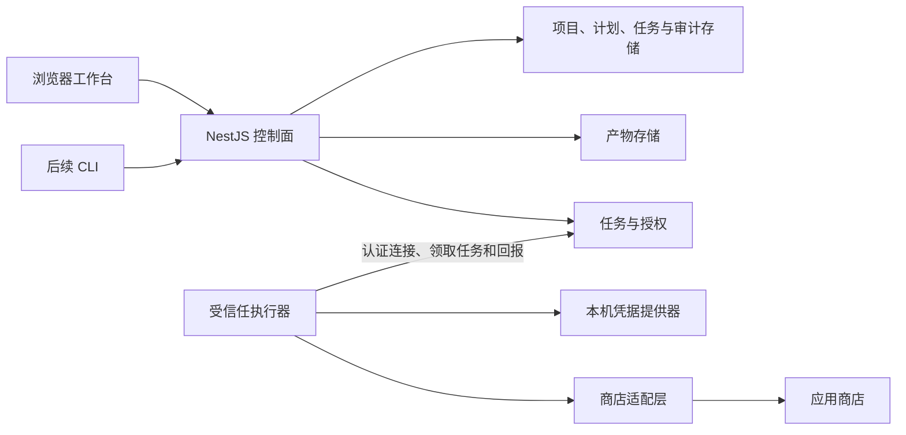

# 产品架构设计

## 菜单短地址与浏览器历史定位（2026-11-10 用户更正）

用户明确要求应用发布页与其他菜单均只保留 `view`，取代此前将页面筛选和详情放入地址栏的导航安排。公开页面定位经统一白名单保存在带版本的 `history.state.harborNavigation` 中；菜单地址与页面定位分别表达，订阅同时响应同地址不同历史项的切换。刷新保留当前项，前后退恢复原定位，菜单点击进入该菜单首页。

旧完整查询链接优先导入后原位缩短，保留原计划、批次和记录身份；复制新短地址只进入对应菜单，不借助全局缓存推断应用。历史状态仅包含公开筛选、标识和返回列表筛选，不保存账号材料、表单草稿、安装包或授权。所有导航与迁移只读本机，不触发商店查询、准备、上传或确认。

## 工作台入口与首次使用（2026-11-08）

发布中心继续作为首页，三个快捷入口只筛选本机处理中、待确认和结果待核对。日常五项菜单加帮助与支持；应用默认平铺，配置向导、统一渠道选择和发布页上传贯通，原授权、真实动作及旧深链边界保留。新增统一启动、环境检查与 macOS 双击入口，不增加远端发布能力。此安排更新历史独立帮助菜单、逐项目进入与预检命名。详见[实施方案](plans/workbench-usability-plan.md)与[快速指南](guides/workbench-quick-start.md)。

## 本机效率增强（2026-11-08）

本轮在既有本机单实例上增加白名单备份、整代恢复、用户开启的状态跟踪和通知。`local-maintenance` 同时约束 HTTP 请求与调度任务；备份／恢复只在没有活动发布、导入、查询和账号配置时进入维护。独立账号配置进程暂停后重启，不沿用秘密录入会话。

业务存储由 `.local/active.json` 选择活动代，凭据根保持原位置。恢复在隔离代重新校验、保留当前快照并最终原子切换指针，旧宿主关闭后重新装配全部存储与执行器。`.local/release-safety.json` 独立于可恢复业务代；写许可先落保护账本、后落业务文件，中断只允许多阻塞而不能漏保护。同机旧计划及预检退役，跨安装导入保持只读；不声称跨机器锁或无缝迁移。

跟踪只调用既有 `StoreStatusService`，与手动查询共用全局并发和渠道预约；SDK、秘密及官方网络仍在可信 worker。`local-efficiency.json` 同时原子保存任务基线和有界通知，避免状态提交后永久漏报。默认关闭自动备份及浏览器通知，跟踪须按绑定显式开启；页面 GET 只读缓存。运行依赖 API 进程，电脑休眠或退出时不保证执行，恢复后不补跑积压轮次。操作和数据清单见[指南](guides/local-efficiency.md)与[验收](verification/local-efficiency-2026-11-08.md)。后续带日期的历史架构保留当时边界。

## 本机日常维护与配置复用（2026-11-08）

`LocalProductivityService` 通过当前可信目录和现有存储读取实际容量／引用，控制面不加载 SDK。清理与备份删除共享 `LocalMaintenance`；产物清理额外检查持久化后台事实，先保存 failed／removed 再删字节，启动继续收尾。旧发布快照、授权和安全账本不改写。下载只允许归属核对后的 ready 记录，打开普通文件并校验大小、SHA-256 后流式返回，不接受公开路径。

`POST /api/local/artifacts/delete` 复用维护来源标记与显式确认，最多一百项。删除持有 `LocalMaintenance.task` 共享占用，与备份、恢复及原文件清理等独占维护互斥；工作台读取和其他包的导入、准备或执行可并行。产物目录扫描、指定记录的归属与全组 `failed` 状态核对（包含 `failureCode=removed`）、文件删除使用同一单进程队列。可用、接收中、检查中项默认拒绝；并发删除已不存在的记录返回 404。历史引用不阻止删除，删除不触及预检历史、计划、回执、授权和安全账本。文件故障可能部分完成，页面提示重新读取，不自动重试。存储 schema 与公开产物合同不变。

新增 `release-presets.json` schema1 保存最多一百份安全配置模板，并加入备份白名单及归属验证。历史只投影字段，复用不产生发布准备或旧授权；具体时间和安装包必须重新选择。模板写入复用串行队列与同目录原子替换，未知格式拒写。跟踪任务页与运行诊断仅读本机事实；固定工具可执行性探测由 runner-local 提供，不运行用户命令、不查询商店权限。

## 部署形态

图中在线任务存储与远程执行器认证是目标架构。当前已实现 Ant Design Web、NestJS 控制面、本地文件存储、商店账号向导、独立检查／预检／发布执行／审核查询 worker，以及本机备份恢复、跟踪、通知和维护；在线目录的身份、成员权限与 PostgreSQL 已在 P5-1 单独接入；P5-2 已接入版本化对象直传，远程执行器配对与发布事务仍待后续。

项目继续使用已有 `projects.json`；应用与绑定共同保存在带 `schemaVersion: 1` 的 `applications.json`，通过同一队列和原子替换保护身份、商店目标唯一性及绑定 revision。新文件的引入不迁移旧项目文件；不支持多个服务实例共享写入。绑定仅包含公开凭据引用，不内嵌可过期的预检结论。

产物采用 `artifacts/{UUID}/record.json` 与固定内部字节文件，原始文件名只用于展示。API 负责流式接收、计数、摘要、配额和状态持久化，接收完成后返回 202；`runner-local` 在独立 Node 子进程重新核对 inspect-only 动作、任务身份、目标、路径与字节摘要，再调用 SDK。私有协议含路径，仅在可信父子进程间使用，不能放进 `packages/contracts` 或接受浏览器直接指定。结果使用随机 nonce 关联并经过安全投影；停止／重启不重跑未完成检查。该本机信任模型不是远程执行器配对认证。

凭据由本机配置服务或维护 CLI 写入本产品 Keychain service 和独立 Vault。API 仅调用 worker 的目录与预检端口，不加载 SDK、不解析秘密；带版本的私有协议只接受 catalog／preflight，预检在解析凭据前核对产物，网络边界仅允许华为鉴权／应用查询、Apple 应用查询及小米固定 /dev/query 查询。禁止重定向、自动重试及商店写动作。API 先保存 running 再返回 202，最终安全事实写入 `preflights.json`；中断恢复为无法验证。查询重算五分钟有效期及绑定、Profile、产物变化，并为历史通过结果重新核对磁盘字节；不在 GET 中重跑商店查询。

## 各层职责

- Web：用户操作与公开数据展示，不读取服务器或执行器路径；局部商店账号向导可临时持有用户输入并直接提交独立本机配置进程，不读取已保存秘密。
- NestJS 控制面：身份、租户授权、项目／应用、渠道配置引用、计划、任务、记录和查询；长时间上传不占用 HTTP 请求处理过程。
- 领域包：项目标识、归属、产物与动作合同、执行规则，不依赖 NestJS 或供应商 SDK。
- 存储实现：当前单进程本地文件；线上使用数据库的租户键、事务与唯一约束，不把文件级互斥冒充多实例能力。
- 执行器：检查产物与本机能力、取得已批准任务、解析凭据、执行和回报；本地和在线环境采用相同任务语义。
- 商店 Adapter：独立封装 SDK 与补充接口，SDK 不直接穿透到浏览器合同。

## 本地与在线的区别

本地版把 Web、API 与未来本机执行器部署在同一台设备，提供便利的个人工作空间。在线版将 Web/API 放到服务器；本地文件需要显式上传至产物存储，或通过已配对执行器选择并登记。浏览器不能把一个用户文件路径交给云服务器直接读取。

Apple 上传工具及 Keychain 等运行约束归属执行器。Linux 云服务器不被假定天然具备 macOS 认证和工具链能力。公网控制台连接执行器时采用经认证的出站连接或拉取协议，不让公网网页默认直连 localhost。

## 计划与执行合同

计划绑定 workspace、project、application、商店目标、产物摘要、动作、更新说明与配置指纹；授权另行绑定具体计划和有效范围。执行器领取任务后再次核对上下文和摘要，才可解析秘密并发起远端操作。

每次执行记录唯一 attempt ID，远端结果不明时进入待核对，不自动重复送审。网络或进程中断不能被描述为远端撤回。SDK 回执、执行事实和远端状态观察分别存储。

## 在线隔离要求

用户身份来自服务端认证，租户范围由受信任上下文获得，所有存储查询和任务授权同时带租户归属。产物访问、下载地址、执行器任务和回执均需相同范围校验；浏览器提供 workspaceId 不能构成授权。

本机仍固定 `local`，本机启动入口拒绝 hosted。P5-1 使用独立的在线验证宿主、独立 Web 构建与 PostgreSQL schema，固定 OIDC 发行者并以受邀身份建立服务端会话。目录和成员维护在数据库事务中核对角色，复合外键约束目录归属。该入口仍只监听回环。P5-2 由浏览器分片直传至私有桶，控制面只签发能力和核对对象版本；已接收包待检查，没有执行器或商店操作。见[在线目录验证指南](guides/hosted-workspace-validation.md)及[安装包直传](guides/hosted-artifact-storage.md)。

## NestJS 选择

后端使用 NestJS Module／Controller／Provider 组织功能，Fastify adapter 处理 HTTP。当前显式注入 ProjectStore，后续可替换为数据库实现，测试通过相同领域入口验证；浏览器和 domain 不依赖 NestJS。

架构随实际功能增加模块，首轮不引入 Redis、数据库 ORM、消息总线或自动化审批等尚未使用的运行依赖。

## 页面内账号配置

`runner-local` 宿主通过固定入口启动独立配置进程，使用带版本及请求 ID 的私有 IPC 交换启动参数、会话控制和安全结果。配置进程在随机回环端口直接接收浏览器材料；NestJS 不代理材料 HTTP。工作台使用精确来源、Host、短期随机能力、固定渠道及单操作关联；能力只存向导内存，材料不进入公共 contracts、通用 API Client、URL、日志或页面缓存。

配置服务复用 SDK 的安全存储，另用 `credential-accounts.json` 保存名称和固定 reference 的操作意图。材料保存与标签文件没有跨文件事务，SDK 故障或重启无法核对时标记待核对，不自动重发；目录和预检禁止使用待核对档案。旧 CLI 档案无标签时使用原引用，无需重录秘密。元数据可读不代表 Keychain 解密或商店鉴权通过。

账号维护通过安全元数据动作交给同一配置 worker，名称编辑不改原引用；重新录入使用绑定原引用和管理版本的短期会话，实际保存前再次比对版本。删除在控制面的绑定写队列内确认无引用，worker 先隔离、再清理材料、最后移除标签。未完成或失败保留待核对。管理版本与预检材料目录版本独立，所有材料替换仍使旧预检失效。

provider 使用 macOS 系统 JXA／Security 桥接代替 SDK 的交互密码管道，材料只经私有 stdin／stdout，写后完整读回比较；继续使用相同 service 和 SDK Vault 格式。目录读取仍不解密；重新核对是用户显式触发的本机读取，不执行商店请求。共享 Vault 主密钥不随单账号删除。

## 本地发布计划与确认（早期切片，后续能力见带日期的更新）

P1-4 将应用、绑定、产物与通过预检的公开事实固定为不可变快照，更新说明与配置分别计算摘要，整份快照形成计划摘要。`release-plans.json` 同队列保护冻结请求去重、确认与取消，快照与授权同文件原子替换。未知版本或指纹损坏拒绝覆盖。

写接口要求精确本机来源和专用请求头，确认同时要求预期摘要与明确同意。local_once 授权仅固定计划内容、动作和有效期限，不作为可复制的执行能力；有效期不超过原预检期限。查询与确认重算目录、绑定、产物记录和实际字节，取消或失效的确认不得使用。此保护适用于单进程本地版，不是在线认证或跨文件事务。

本机执行接口将一次性消费与 attempt 同文件原子提交，版本 1／2／3／4／5／6／7／8 计划文件兼容升级为版本 9。固定 worker 通过私有 stdin 接收计划与目录，nonce 关联 IPC；API 不加载 SDK。worker 重算指纹、复核独立产物副本及账号目录版本，并只读查询商店目标。上传前要求 API 再核对依赖、持久化远端许可后才开始。执行中进程退出或回执丢失均按许可事实恢复为中断或待核对，重启不重放。

SDK 回执留在 worker 内存，产品仅记录固定状态与时间。华为固定 draft、单次上传且不送审。待核对目标未记录人工结论前禁止新计划再次上传；核对结论只附加到原始未知终态，未保存且无处理中任务时可用新计划，已有草稿时仍阻止相同摘要产物重复上传。Apple SDK 0.3.0 的上传工具调用不能消费现有 API Key，因此消费前明确拒绝，保留确认；真实渠道验收仍未完成。

## 执行诊断与人工核对

固定 worker 仅回传白名单诊断码，API 保存安全原因与建议；不接收供应商正文、秘密或路径。历史没有诊断码时保持缺失，不能事后推测。写入许可后的异常依旧待核对。小米上传将请求超时、中止、网络异常、HTTP 非成功、回执格式异常和业务非成功映射为固定码，经私有 IPC 保留到原执行回执；控制面不再统一覆盖为 remote_unknown。许可前原因不得冒充上传原因，未细分的异常仍保持宽泛原因，不保存供应商正文或原始异常。

人工核对要求精确本机来源、完整归属、计划摘要和版本一致、明确同意。结论附加到已结束的未知结果，不修改原始回执；同结论幂等，相反结论冲突。核对及新执行串行处理，解除阻塞不触发任务。人工声明与自动商店核验有明确区别，用户仍须确保后台没有处理中任务。

## 自动准备与一次确认

准备请求以当前绑定版本、产物摘要和说明形成公开意图。系统先持久化 preparation，再后台运行只读预检并冻结未授权快照；HTTP 返回 202，刷新只读取进度。进行中重启标为中断，不重放。预检与准备关联之间中断时可能保留无授权检查／快照，但不能派发商店写入。

发布页在摘要内只要求一次明确执行确认。confirm-and-execute 在同一存储队列内检查目标、摘要、期限、单槽及待核对阻塞，再原子产生／消费授权和执行尝试；失败不保存孤立确认。旧确认只复用不续期，原历史接口保留兼容。存储版本 4 增加 preparations，读取兼容版本 1／2／3。当前开放华为草稿及小米／OPPO／vivo／魅族／荣耀普通应用更新，Apple 暂缓。小米增加公开图标、商店名称及隐私政策，计划文件升级为版本 6；旧快照保持原指纹。

## 小米已有应用更新

小米以包名定位，绑定目标等于 Android 身份；账号材料与审核测试登录资料仅在独立配置进程及可信 provider 内解析。页面用表单生成新版测试结构，不公开回读。小米只读查询为固定端点 POST，不等于商店写入；要求 result=0、目标包名相同及明确 updateVersion=true。SDK 预检没有检查更新许可，provider 以独立受限 transport 补齐，不放宽华为或 Apple 白名单。

公开 PNG、摘要、后台应用名称与隐私政策随计划冻结，拒绝字段、字节及渠道错配。小图标内联上限 256 KiB，普通请求和私有 worker stdin 上限 512 KiB，不接受用户本机路径。控制面不接收测试账号秘密。

provider 固定 synchroType=1、单 APK，执行前再次查询并比对商店名称、复核实际 SHA-256 和大小，取得持久化写入许可后单次推送。只有明确 result=0 显示 review_submitted，任何许可后不确定均保留待核对；不自动新增、重试、查询审核或控制上线。成功回执及人工确认已有提交均阻止相同安装包的新计划再次送审。旧草稿核对枚举保留，新小米核对使用 submission_present／not_submitted，服务端限制动作匹配。

## 上架意图与自动资料复用

releasePolicy 以 after_approval／scheduled 表达统一意图，定时使用规范 UTC notBefore，浏览器选择器显示设备时区。策略进入准备去重及不可变计划；创建、确认、远端许可与 worker 都检查时间，过期不降级立即。历史缺失不回填，旧小米计划缺少选择时消费前拒绝。小米定时映射 onlineTime 毫秒，立即模式不设置延期时间；华为草稿与 Apple 上传不设置审核版本策略，摘要明确记录未同步。iOS 可以准备含该意图的计划，执行仍拒绝，不恢复暂缓上传。

小米准备时在可信 worker 中先认证查询，再从固定 https://app.mi.com/details?id=包名 读取公开上架资料，核对包名和名称，仅从 file.market.xiaomi.com 的固定原图入口取回 PNG；不携带凭据或测试账号、不跟随重定向、不访问隐私政策第三方网站。公开页面上限 512 KiB、图标上限 256 KiB。无法解析、匹配或读取时失败，不传空资料。自动来源由执行器生成，浏览器不能声明来源证据。

预检安全结果可携带经过校验的公开 xiaomi 资料，控制面固定进计划及来源时间，执行继续使用快照字节而不重新下载。计划文件版本 6 兼容读旧记录；小米资料在预检与快照各保留一份，私有发布 worker stdin 预算 1 MiB，预检 stdout 预算 512 KiB，均不承载秘密。文件损坏继续拒绝覆盖。

## 小米执行核对的唯一责任

独立执行器继续核对计划、实际产物、副本与凭据目录；小米的目标及名称核对统一由提交适配器执行一次，避免执行器和适配器连续查询触发平台频率限制。可信 ReleaseProvider 仅供本机装配和测试注入，不接受任务或环境变量切换。频率限制、材料、目标、产物及许可使用固定诊断码，不输出供应商原文或秘密。

授权消费是审计事实，页面须优先展示真实执行结果；没有远端许可的失败明确标“未上传”，小米审核提交和华为草稿不得共用成功文案。历史宽泛原因不反填为后来观测的细码，也不因修复自动重试。

## OPPO 普通应用单包更新

OPPO 账号复用本机安全配置进程；包名绑定、预检与独立执行均采用严格白名单。当前仅已上架普通应用、全量单包且构建号递增。准备从详情固定公开资料、来源版本和构建号，测试说明、商务联系人、支付密钥不进入公开合同或摘要。执行从相同来源版本复用私有审核资料，公开资料变化则拒绝。

provider 独立补齐 SDK 缺失的定时与异步处理：HMAC-SHA256 签名、token／详情、上传配置、平台 HTTPS 上传、MD5／大小校验、单次版本提交及有界 task-state 只读观察。不允许重定向或任意上传地址；商店材料链接只作同平台参数，不由控制面下载。一次许可覆盖单次文件及版本写入，许可后的异常继续保持待核对，固定原因保留到回执。任务成功必须同时匹配包名和构建号，不能将 errno=0 或 data.success=true 直接当成审核成功。

当前存储版本 9 兼容读取 1–8，不改写既有快照指纹；新增 OPPO 公开来源和版本处理结果。立即映射 online_type=1，定时映射 2 及中国标准时间 sche_online_time。此时区约定须在真实商店验收核对，不以工程替身证明后台已生效。真实提交仍由用户在具体计划显式触发；vivo 在后续独立切片接入，见下节。

## 问题与解决中心

仓库 `docs/issues/catalog.json` 为 AI 维护的唯一档案来源，公开合同整体校验字段、日期、编号、状态、关联和文档路径；已知 preflight 分类只读映射为 publishing，未知分类拒绝。API 仅提供目录、编号详情和已登记证据的只读查询；受本机 Host／Origin 保护，无仓库写入口或 SDK 依赖。缺失／损坏返回 503，不伪造空目录。证据按序号查询并验证真实路径，以有界纯文本返回。

构建验证并复制知识库和证据到 Web 发布资源，生产按固定 webRoot 装配，无需从工作目录寻找源码。页面使用纯文本、分页表格和详情抽屉；URL 保存 view、搜索、筛选、页码和选中编号，前后退只恢复定位。问题已解决、根因已确认与商店执行成功仍是不同事实。

## 发布中心与配置导航

工作台按“发布”“配置”“了解与支持”分组，分别使用“发布中心”“应用管理／商店账号”“问题档案／商店指南／产品路线图”六个入口。发布中心承载跨项目的单渠道计划和 Android 多渠道批次；应用管理保留项目、应用身份、绑定、安装包与只读预检配置，按项目／应用筛选跳转发布中心。iOS 上传构建与已有构建审核／手动发布均在发布工作区，配置页不再挂载审核面板；旧审核深链只恢复新位置。

`GET /api/release-center` 固定当前本机可信工作空间，服务端遍历可见项目和应用，调用既有只读有效性、批次和回执查询，将结果投影为公开目录选项与列表摘要。批次所有 revision 的子计划不重复列为单渠道计划。汇总不发送商店请求、不运行预检或发布准备、不发放确认，也不返回快照、账号引用和执行器路径；读取失败明确报错，不伪造空历史。当前按应用顺序读取，避免同时复核过多本机安装包；未来历史规模增长时可替换为数据库只读索引与服务端分页。

前端只发送一次汇总请求，按 URL 筛选项目、应用、渠道、方式、处理阶段和页码。记录详情通过原项目／应用接口恢复已有发布面板；URL 保存原计划或批次 revision 定位，刷新及前后退只恢复查看。原一次确认、过期校验、远端写许可、未知结果核对及批次串行约束继续生效，不因统一入口增加隐式授权。执行完成仅表示执行终态，审核与上架仍以各自事实为准。

## vivo 单包更新边界

vivo 复用安全账号、独立预检与一次确认入口；只从可信查询冻结来源构建号和兼容设备，其他资料省略而保留商店现值。API 不持有签名材料，provider 固定三项网关方法。执行复核来源与实际 APK 后，经持久化许可上传并匹配包名、版本和 MD5，再同步提交；只在 code／subCode 明确成功时记录 vivo_update_accepted。许可后异常保持待核对。schema9 容纳 vivo 安全来源与结果，读取旧版不回填和不改摘要。

## 魅族与荣耀完整送审边界

两家数字商店 App ID 与包名独立核对；公开预检来源只带版本锚点、公开资料摘要或白名单语言信息，私人备案与审核资料不出 provider、不参与指纹。魅族查询完整分页与确定版本，复用既有材料上传并发布，返回新 verId 后核对在审事实；定时明确拒绝。荣耀核对已上架版本和当前流程，在获取文件对象前取得一次许可，单次上传／绑定，核对文件 SHA 和编辑态版本，setAll=0 只更新默认语种后按冻结策略送审。私有协议、公开合同与 schema9 同步允许两家来源／结果，旧记录不回填；许可后任何不确定结果须人工核对，不重试。

## 2026-11-05 Apple 上传切片更新

用户已授权恢复 Apple，本轮接入团队 API Key 的 IPA 独立上传与上传后一次构建状态核对；上架类型及说明仅记录意图，尚不送审、不设置上架。此更新取代前文 Apple 执行暂缓的当前状态描述，历史切片事实保留。存储写入版本 10、读取兼容 1–9。当前工程验证与真实验收分开记录，真实上传待用户在具体计划触发；后续再接选择构建、审核与上架闭环。详见[Apple 上传说明](guides/apple-build-upload.md)。

按用户最新纠正，iOS 发布方式为审核通过后自动发布或手动发布，不提供指定时间选项；新准备及冻结拒绝 iOS 定时／Android 手动策略，旧 iOS 定时快照只读保留且不可执行，须重新准备。选择随计划固定，本轮仅记录，后续送审时再同步 Apple。

## 2026-11-05 Apple 审核与发布更新

已有构建选择、版本及可读取审核资料检查、一次确认送审、自动／手动发布设置、已批准版本的独立手动发布及显式状态观察已工程接入，真实待验收。iOS 进入“审核与发布”，不用再次上传 IPA；原上传入口保持独立。使用已有商店版本及资料，不自动新建版本或代填合规内容；缺项时引导到后台完善。计划存储写入 schema11，读取兼容 1–10，原上传及 Android 执行槽、未知结果阻塞和旧事实均保留。此更新取代前文审核待开发的当前进度表述，历史切片事实不改写。详见[使用说明](guides/apple-review.md)。

Apple 审核记录保存在 schema11 的 `appleReviews` 数组，和 `plans`、`attempts`、`preparations` 同队列、同文件原子替换。`consumedAt` 固定单次确认，`remoteStartedAt` 为写入许可事实；启动只恢复未完成项。快照指纹不可重写，后续 `observation` 和 `reconciliation` 仅附加事实，不覆盖原回执。固定 Apple worker 通过带版本及 nonce 的私有协议接收安全目标，材料仅在 worker 内解析；控制面及公开合同无 SDK、JWT、测试登录材料或执行器路径。

## 2026-11-05 应用宝与鸿蒙更新

按用户新指令同时接入两家，取代前文尚待排期的当前进度。应用宝支持已有普通软件单 APK 更新，资料沿用、HMAC 签名、COS 上传后一次送审；鸿蒙增加独立 harmony 平台、正式 APP 检查、分片上传、包解析及版本核对、默认语言说明和完整送审。两家支持立即／指定时间，明确发送商店参数；不把草稿、文件接收或审核受理视为已上架。日常仍是“准备发布 → 核对摘要确认一次 → 查看结果”。

计划存储写入 schema12，读取兼容 1–11，保留 Apple 审核记录和原快照指纹。许可后不明确结果保留待核对，不重放；控制面不加载 SDK 或秘密。仅本机单实例、已有应用更新，真实渠道验收待用户具体计划触发；未执行真实鉴权、上传或送审。使用及范围见[指南](guides/tencent-harmony-updates.md)。

## 2026-11-06 多渠道批次工程实现

首版批次限定同一 Android 应用的多商店，沿用已有适配，不在 API 内加载 SDK。批次准备逐项复用单准备槽，逐项冻结归属明确的子计划；确认后只记录排队项，每次领取再创建一个 attempt。单渠道、批次和 Apple 审核／手动发布共用全局写入并发 1 和同文件准入，不能另开绕过既有槽的调度器。

在 schema13 增加 batches 聚合，兼容 1–12，保留 Apple 审核及旧快照指纹。批次确认、目标预约、尝试、首次写许可和停止经同一原子替换队列。批次新 scope 及明示窗口和单渠道 local_once 分开；排队项临执行重新验证同一意图并追加白名单证明，不伪造旧计划确认或延长原预检。原始回执和未知保护保留，重启不续跑未开始队列。完整合同、时间边界和实现切片见[方案](plans/android-release-batches-plan.md)；应用内已开放批次入口。旧 local_once 不变；新 local_batch_once 固定 60 分钟开始写入窗口，各目标真实复核证明不超过五分钟。可信 worker 使用完整有序 manifest 独立验证摘要及成员关系。工程自动化与真实验收分别记录。

## 2026-11-06 发布中心 iOS 记录补齐

汇总增加 `kind=apple`，从 AppleReviewService 的只读历史端口投影审核及手动发布摘要。存储新增按工作空间／项目／应用过滤的 `appleReviews` 读取方法，历史查询不再进入事务写路径，不升级存储或续期；写入和执行授权流程保持独立。已有观察和人工结论仅显示安全状态及时间，不返回绑定、凭据引用、快照、摘要指纹或原始响应。

列表与方式筛选区分 iOS 上传、审核和手动发布；详情通过 `appleRecord` 恢复当前应用记录。缺失记录明确提示，历史读取失败支持手动恢复；浏览器刷新与前后退不触发审核、上传或上线。当前仅完善第二期体验，第三期暂缓。

## 2026-11-06 第三期状态观察首片

ReleaseObservationService 从可信本机工作空间内的已执行荣耀计划恢复目标，校验当前绑定后，通过 LocalReleaseObservationRunner 的固定 worker 查询。API 不加载 SDK、不接收浏览器指定的版本或商店路由；worker 验证带版本的私有 stdin 与 nonce，解密和认证仅在可信进程。provider 固定只读路由，保留响应预算、超时和禁止重定向，不提供上传或写许可。

观察与查询预约保存在独立 `release-observations.json`，单进程串行预约、同目录原子替换；查询成功与失败独立追加，原计划存储版本不变。GET 历史不发商店请求，POST 显式查询需要既有本机来源保护且拒绝目标覆盖字段。相同荣耀 App ID 的不同计划共享节流：成功查询三小时，失败一分钟，未完成预约重启保留三小时，不自动重查；这是产品的保守策略，不冒称 GET current 的官方硬限制。审核未通过或已上架观察复用原记录，不再次派发；仅审核通过时仍可在间隔结束后核对上架。

荣耀 current 的版本名和构建号必须匹配，其他版本保留未知；detail.releaseInfo 的已上架版本独立匹配后才可显示 published。审核意见、附件和完整响应不越过 worker，界面引导到后台核对。首片只在发布摘要及执行详情展示，列表汇总和批次目标跟踪在 P3-2 扩展，其他渠道逐家核实。

## 2026-11-06 审核状态独立菜单修正

用户明确第三期应作为独立菜单，并指定名称“审核状态”。该菜单与发布中心并列，原发布摘要及执行详情移除查询面板，仅携带项目、应用、记录 ID 跳转。荣耀观察组件移到审核状态模块，使用最小定位字段读取，不再要求完整发布快照。

`GET /api/review-tracking` 固定可信本机空间，汇总已结束且取得远端许可的送审操作，逐渠道列出单渠道计划及批次子目标；草稿、构建上传及未执行计划不冒充审核记录。Apple 已发生的送审／手动发布及既有观察只读投影。汇总只读存储，不复验安装包、不发商店请求、不签发授权；故障整体报错。响应不携带快照、凭据引用或授权。

`view=reviews` 和 review 前缀 URL 字段恢复菜单、筛选、分页及详情。荣耀查询继续调用原有受限端点，只有明确点击才派发。查询结果在详情独立显示，关闭后列表重读本机汇总；Apple 的待手动发布根据已有观察提示回到原发布流程，原结果不明仍优先保留核对要求。

## 2026-11-06 魅族确定版本观察

发布 worker 在核对新送审版本详情后通过限定 IPC 回报 reviewAnchor，宿主校验同次 nonce、许可及动作，只接收首个合法新版本锚点。控制面将锚点与原执行终态在同一原子事务保存，计划存储写入 schema14 并兼容读取 1–13，旧快照和指纹不变。缺失锚点不自动恢复、不按名称猜测，也不触发重提。

审核状态通过原执行锚点构造私有只读任务，固定鉴权与确定版本详情端点；App ID、包名、verId 和版本名不符则保留未知。魅族不提供独立构建号，关联仅来自原执行，页面明确说明；只输出安全状态、平台码及时间，不传播私人资料。独立观察存储及目标共享冷却沿用原流程，查询不改回执、授权或未知保护。

## 2026-11-06 官方状态查询与本地发布解耦

用户明确更正：审核状态应直接查商店，不以本地发布记录为前提。此安排取代前述仅已执行记录及锚点限定的主入口；旧按计划观察仍在“本地发布关联”保留，不能混淆目录版本与原执行关联。

默认“商店状态”列出当前应用的所有绑定，官网手动提交版本亦可查询。魅族读取官方 `/app/versions` 目录（没有构建号）；荣耀分开当前审核流程与已上架版本；Apple 读取版本及构建目录。vivo 只映射已核实待审核状态；OPPO、应用宝、鸿蒙读取官方版本资料，未核实审核字典时保持未知。小米说明官方未开放；华为 Android 说明独立查询尚待核实接入。具体范围见[查询指南](guides/release-status-observations.md)。第三期资料待办仍在后续范围，不能据此标记第三期完成。

新 GET `/api/store-status` 仅读取可信绑定目录与缓存；POST `/api/store-status/:projectId/:applicationId/:bindingId/query` 要求本机来源及固定标记、空正文，从目录恢复目标进入独立 worker。API 不加载 SDK 或凭据。新 `store-status.json` 以绑定指纹隔离预约和快照，单进程队列原子写入；未完成预约三分钟、已完成十秒内避免重复，不自动重试。失败保留上次成功及其时间，导航不请求商店，不改写任何计划、回执、授权及人工核对。真实查询由用户具体目标另行验收。

## 2026-11-07 查询范围与状态精度补齐

所有既有渠道现在均提供独立查询入口。华为 Android 与鸿蒙分别使用固定 v2／v3 全网端点和已核实字典，明确的在架旧版不覆盖当前流程；vivo 补齐官方字典。应用宝审核与版本资料分别投影，不建立官方未返回的版本关联。OPPO 仅映射有依据的“上线”，未核实码仍保留未知。

Apple 独立状态只读取商店版本及其已关联构建，不再依赖全量 TestFlight 构建；旧审核准备的构建路由同步修正，完整性预算保持独立。小米读取固定官方公开页并验证包名，展示范围为“公开在架”，不发送凭据或请求更新许可；该分支不读取 Vault 版本，避免无关的账号目录缺失阻断公开查询，其余认证渠道仍前后核对凭据目录版本。

公开快照兼容新增状态及 `request_rejected` 分类，缓存文件格式不变。商店请求被拒绝与网络失败分开；页面只输出固定建议。实际只读复验及官方依据见[渠道修复记录](verification/store-status-channel-fixes-2026-11-07.md)。

## 2026-11-07 送审查询范围复核与状态标签

OPPO 官方字符串字典集中在可信 provider，有限合同新增阶段状态，不公开原始审核描述；“00”与“0”不混同，负码与前导零码不写入非负整数 rawState。未知码或已知描述冲突保持未知，不使用应用级在架字段覆盖版本审核。缓存格式与旧计划不变，API 只更新能力提示；指定构建号查询、历史 releaseId 锚点与回调不属于本轮新增能力。

列表、手机卡片与详情共用 Ant Design 状态标签，摘要去重并支持换行，文字、版本归属和非实时时间继续保留。各平台送审后是否可查及替代方案见[核对记录](verification/submitted-review-capabilities-2026-11-07.md)。本轮没有真实上传、送审或发布，不据此标记第三期全部完成。

## 2026-11-07 版本定位与待办首版

审核状态已增加“待办处理”，基于已有缓存整理拒绝、待手动发布、查询失败、后台核对与草稿资料提示。详情分组展示当前流程、在架与历史；Apple 等待开发者发布与等待商店发布分别表达。OPPO 可按构建号定位并校验响应，小米可追加带人工来源和时间的核对记录；均不依赖本机发布计划。

荣耀新送审的审核单 ID 随终态可靠保存，原执行关联按该单查询；通过后仅继续核对在架事实，旧审核时间保留。计划存储写 schema15、兼容读取1–14；独立商店缓存写 schema2、兼容schema1，旧摘要和记录不猜补。人工记录不会覆盖官方结论或解除未知执行保护。第三期资料检查目前为有限字段提示，完整合规资料及逐渠道真实新送审验收仍须另行完成。操作与边界见[状态查询指南](guides/release-status-observations.md)。

## 2026-11-07 查询证据留存

独立商店缓存写 schema3，兼容读取 schema1／2，GET 不写迁移。每绑定指纹最近三十次官方查询保存成功、失败及未变化结果，与默认／指定构建的最近缓存同队列原子写入；旧缓存不回填。公开 queryHistory 只包含原安全快照，绑定变化隔离，人工来源仍独立。详情折叠分页读取，不主动请求商店。

变化比较仅限同绑定、同范围的较早成功及可唯一定位的相同版本；缺标识、标识变化或重复不猜关联。目录缺项不等于下架，查询时间不等于状态实际变化时间；失败不生成变化，也不授予发布权限。完整资料读取和逐渠道新送审场景真实验收继续留待后续。

## 2026-11-07 Apple 指定版本资料检查

状态查询缓存写 schema4，兼容读取 schema1–3。Apple 资料检查以绑定指纹和明确版本 ID 隔离，最多保留最近五个版本，各自保留最近失败与上次成功；旧格式仅读取、不回填。固定只读 worker 先重新核对 App ID、Bundle ID 和版本归属，再读取有限语言资料、截图上传状态及审核详情字段。联系人、登录资料、网址和意见只在 worker 内存中使用，公开合同仅接收固定检查状态；隐私及完整合规资料未接入时必须标记未检查。该报告不改变发布计划、授权、回执或人工核对，也不证明送审资格。

## 2026-11-07 华为 Android 正式更新送审

第四期 P4-1 工程接入独立 huawei_submit_review，默认草稿及批次行为保留。正式更新由只读预检冻结唯一目标、已上架来源、默认语言与公开摘要；固定 worker 在持久化许可后执行 v2 单 APK 上传、文件绑定、默认语言更新说明、两分钟等待及一次送审。回读同构建在审才记录受理，许可后异常待核对、不重试；立即／定时随送审参数发送，不视为已上架。计划写 schema16、兼容1–15，旧指纹不变，读取零迁移。新增送审真实验收待做。见[华为指南](guides/huawei-android-updates.md)。

## P4-2 目标一致性与版本防重

单渠道和 Android 批次复用同一目标保护，在确认及写入许可边界拒绝已受理的相同产物或相同版本；重新打包产生新摘要也不扩大授权。Android／鸿蒙按构建号、魅族按版本名、Apple 上传按市场版本与构建号组合核对。未知结果仍阻塞目标，人工确认已存在保留保护，确认不存在及写前失败允许新准备。旧快照与回执不回填、schema 不变。鸿蒙摘要展示冻结的默认语言；逐渠道来源、语言及动作边界见[核对记录](verification/release-target-consistency-2026-11-07.md)。本机防重不代替官方版本约束或锁定外部后台。

## 2026-11-08 第四期工程收尾

P4-0 至 P4-5 的有限更新流程与 P4-6 工程验证／验收整理已交付，逐渠道真实送审、定时生效及上架仍待具体计划核对。资料更新沿用已核实的说明写入与必需资料复用，摘要明确范围和语种，完整图文与合规主动编辑引导官方后台。OPPO版本任务、vivo更新受理、审核提交和上架各自保留事实。秒级定时统一向后取整，小米毫秒字段不变；OPPO／vivo时区为工程映射，Apple定时为本项目不开放而非官方不支持。本轮收尾未新增商店写路由、schema、授权、调度或在线身份。详见[收尾记录](verification/phase-4-completion-2026-11-08.md)和[操作指南](guides/release-orchestration.md)。第五期尚未开始。
