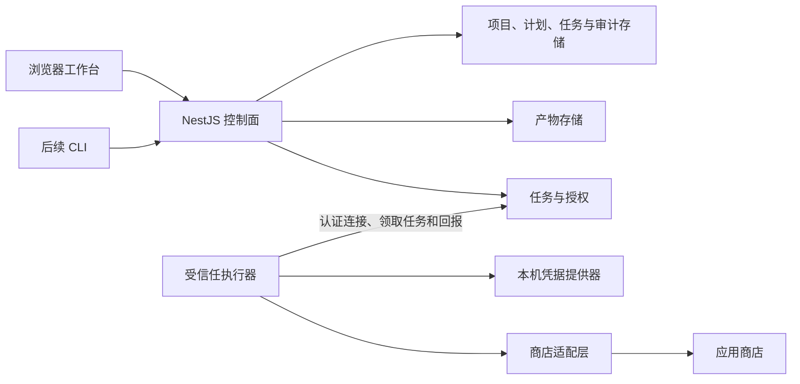

# 产品架构设计

## 部署形态

图中在线任务存储、远程执行器认证和远端发布是目标架构。当前已实现 Ant Design Web、NestJS 项目／应用／商店绑定／产物／只读预检 API、本地文件存储、安全 Profile CLI，以及产物检查和只读预检本机子进程，其余逐期落地。

项目继续使用已有 `projects.json`；应用与绑定共同保存在带 `schemaVersion: 1` 的 `applications.json`，通过同一队列和原子替换保护身份、商店目标唯一性及绑定 revision。新文件的引入不迁移旧项目文件；不支持多个服务实例共享写入。绑定仅包含公开凭据引用，不内嵌可过期的预检结论。

产物采用 `artifacts/{UUID}/record.json` 与固定内部字节文件，原始文件名只用于展示。API 负责流式接收、计数、摘要、配额和状态持久化，接收完成后返回 202；`runner-local` 在独立 Node 子进程重新核对 inspect-only 动作、任务身份、目标、路径与字节摘要，再调用 SDK。私有协议含路径，仅在可信父子进程间使用，不能放进 `packages/contracts` 或接受浏览器直接指定。结果使用随机 nonce 关联并经过安全投影；停止／重启不重跑未完成检查。该本机信任模型不是远程执行器配对认证。

凭据由可信 CLI 写入本产品 Keychain service 和独立 Vault。API 仅调用 worker 的目录与预检端口，不加载 SDK、不解析秘密；带版本的私有协议只接受 catalog／preflight，预检在解析凭据前核对产物，网络边界仅允许华为鉴权／应用查询和 Apple 应用查询。禁止重定向、自动重试及商店写动作。API 先保存 running 再返回 202，最终安全事实写入 `preflights.json`；中断恢复为无法验证。查询重算五分钟有效期及绑定、Profile、产物变化，并为历史通过结果重新核对磁盘字节；不在 GET 中重跑商店查询。

## 各层职责

- Web：用户操作与公开数据展示，不读取服务器或执行器路径，不接触解密商店凭据。
- NestJS 控制面：身份、租户授权、项目／应用、渠道配置引用、计划、任务、记录和查询；长时间上传不占用 HTTP 请求处理过程。
- 领域包：项目标识、归属、产物与动作合同、执行规则，不依赖 NestJS 或供应商 SDK。
- 存储实现：当前单进程本地文件；线上使用数据库的租户键、事务与唯一约束，不把文件级互斥冒充多实例能力。
- 执行器：检查产物与本机能力、取得已批准任务、解析凭据、执行和回报；本地和在线环境采用相同任务语义。
- 商店 Adapter：独立封装 SDK 与补充接口，SDK 不直接穿透到浏览器合同。

## 本地与在线的区别

本地版把 Web、API 与未来本机执行器部署在同一台设备，提供便利的个人工作空间。在线版将 Web/API 放到服务器；本地文件需要显式上传至产物存储，或通过已配对执行器选择并登记。浏览器不能把一个用户文件路径交给云服务器直接读取。

Apple 上传工具及 Keychain 等运行约束归属执行器。Linux 云服务器不被假定天然具备 macOS 认证和工具链能力。公网控制台连接执行器时采用经认证的出站连接或拉取协议，不让公网网页默认直连 localhost。

## 计划与执行合同

计划绑定 workspace、project、application、商店目标、产物摘要、动作、更新说明与配置指纹；授权另行绑定具体计划和有效范围。执行器领取任务后再次核对上下文和摘要，才可解析秘密并发起远端操作。

每次执行记录唯一 attempt ID，远端结果不明时进入待核对，不自动重复送审。网络或进程中断不能被描述为远端撤回。SDK 回执、执行事实和远端状态观察分别存储。

## 在线隔离要求

用户身份来自服务端认证，租户范围由受信任上下文获得，所有存储查询和任务授权同时带租户归属。产物访问、下载地址、执行器任务和回执均需相同范围校验；浏览器提供 workspaceId 不能构成授权。

当前本地固定 local workspace 和存储测试只说明代码具备隔离接口，不代表组织认证、RBAC、执行器配对或多租户生产能力已完成。

## NestJS 选择

后端使用 NestJS Module／Controller／Provider 组织功能，Fastify adapter 处理 HTTP。当前显式注入 ProjectStore，后续可替换为数据库实现，测试通过相同领域入口验证；浏览器和 domain 不依赖 NestJS。

架构随实际功能增加模块，首轮不引入 Redis、数据库 ORM、消息总线或自动化审批等尚未使用的运行依赖。
