# Release Harbor 图文操作手册

适用版本：本机工作台 0.1.0（个人／团队模式） · 更新日期：2026-11-12

本手册面向日常发版人员，覆盖首次配置、安装包接入、发布确认、审核查询及本机维护。Release Harbor 接收已经构建好的安装包，不负责打包源码，也不在商店创建新应用。完整图文、资质和合规资料仍在对应商店后台维护。

**插图说明：**所有插图来自隔离测试环境中的真实 Chrome 页面，应用、账号、版本和执行结果为合成演示数据。图中的受理、上架等标签只讲解界面，不是实际商店验收证据；实际使用以自己的应用身份、摘要、回执和官方查询时间为准。

## 目录

1. [启动与认识工作台](#1-启动与认识工作台)
2. [启用本机团队与管理成员](#2-启用本机团队与管理成员)
3. [第一次使用：登记应用与配置账号](#3-第一次使用登记应用与配置账号)
4. [导入和检查安装包](#4-导入和检查安装包)
5. [日常单渠道发布](#5-日常单渠道发布)
6. [Android 多渠道批次](#6-android-多渠道批次)
7. [iOS：上传、审核与手动发布](#7-ios上传审核与手动发布)
8. [查询审核与上架状态](#8-查询审核与上架状态)
9. [自动跟踪、待办与通知](#9-自动跟踪待办与通知)
10. [单渠道复用历史配置与常用模板](#10-单渠道复用历史配置与常用模板)
11. [备份、恢复与空间维护](#11-备份恢复与空间维护)
12. [异常处理速查](#12-异常处理速查)
13. [每次发版核对清单](#13-每次发版核对清单)
14. [保存 PDF、图片来源与维护说明](#14-保存-pdf图片来源与维护说明)

## 1. 启动与认识工作台

### 1.1 首次准备与日常启动

准备 Node.js 24、pnpm 11.20.0 和已构建的 APK、IPA 或 HarmonyOS APP。当前安全凭据存储支持 macOS。商店中应已有对应应用，并准备好该渠道要求的接口权限及账号材料。

在项目根目录打开终端，首次执行：

```bash
pnpm install --frozen-lockfile
pnpm workbench
```

日常可双击根目录的 `启动 Release Harbor.command`，或运行 `pnpm workbench`。新实例构建并打开 `http://127.0.0.1:4399`，已有健康实例则复用。关闭本次启动的终端会停止本次服务。启动器不会自动安装缺失工具或结束占用端口的其他程序。

默认是个人模式。开发模式 `pnpm dev` 的页面地址为 `http://127.0.0.1:5178`；已启用团队的工作台请按第 2 节直接访问本机服务。团队账号适用于同一台 Mac，不需要域名、组织账号或云数据库。

### 1.2 菜单与页面定位

| 入口       | 在这里完成的操作                                     |
| ---------- | ---------------------------------------------------- |
| 发布中心   | 发起发布、准备摘要、确认执行、查看本机历史           |
| 审核状态   | 查询官方版本、查看审核／上架状态、处理待办、管理跟踪 |
| 应用管理   | 登记应用、维护渠道配置、管理安装包、发布前检查       |
| 成员管理   | 仅团队管理员可见：管理成员、按应用授权、查看操作日志 |
| 商店账号   | 新增账号、更新凭据、检查本机材料、查看关联应用       |
| 本机设置   | 管理存储、备份恢复、通知与运行诊断                   |
| 帮助与支持 | 商店指南、问题档案、产品路线图                       |

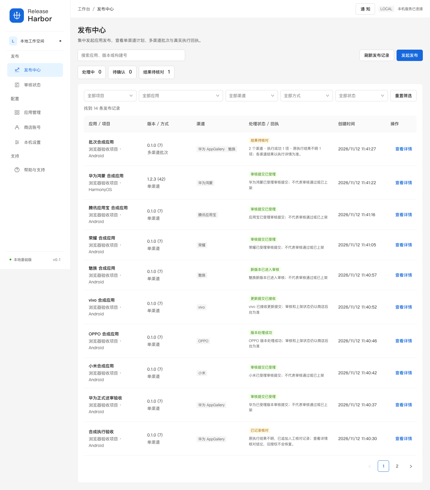

**图 1 定位：**左侧选择菜单，右上角“发起发布”开始本次操作。“处理中”“待确认”“结果待核对”只筛选本机记录；普通失败与过期记录从完整列表查找。

首次可从首页“检查本机环境”或“本机设置 → 运行诊断”检查服务、容量与工具。工具存在不表示安装包已检查通过，也不表示商店权限有效。

地址栏只显示菜单短链接，例如 `?view=releases`。同一标签页刷新及前进／后退可恢复历史项中的筛选、应用和详情；复制短链接到新标签页只会进入菜单首页。旧长链接仍可导入原定位并自动缩短。导航和刷新不会自动查询商店、准备或执行发布。

## 2. 启用本机团队与管理成员

个人使用可跳过本节。团队模式沿用当前 Mac 上的应用、商店账号和发布记录；管理员负责配置，成员按授权查看或操作。早期在线目录和安装包直传是[独立验证入口](hosted-workspace-validation.md)，还不能通过在线入口执行发布。

### 2.1 初始化并登录

1. 停止使用同一数据目录的旧工作台、开发服务和转发。已有数据无需迁移；自定义过 `RELEASE_HARBOR_DATA_DIR` 时，初始化与启动必须使用同一目录。
2. 在项目根目录的本机交互终端运行 `pnpm team:init admin`，按提示输入两次管理员密码（12 至 128 字节）。终端不回显密码，不要把密码写在命令参数里。
3. 执行 `pnpm build && pnpm start`，在这台 Mac 的浏览器打开 `http://127.0.0.1:4399`。自定义端口时使用实际端口。团队登录使用本机直连，不能从开发代理或隧道登录。
4. 在“本机团队工作台”用管理员账号登录。已经启用过团队的安装升级后，重新构建、启动和登录即可，不重复初始化。

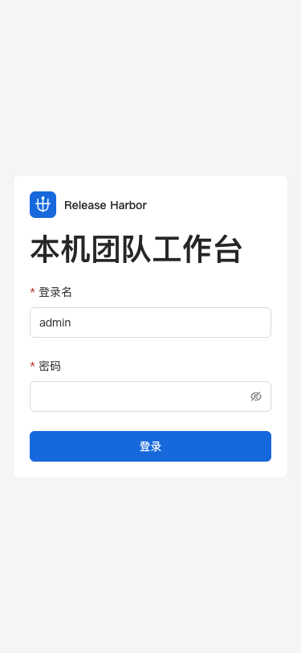

同一浏览器配置中的标签页共享登录会话；要同时验证管理员和成员，请使用独立浏览器配置或独立会话。页头可查看当前账号并退出；服务重启后所有人需重新登录。首位管理员不能通过再次运行初始化命令覆盖，当前也没有自助重置管理员密码的入口。

### 2.2 创建、维护成员

1. 管理员在左侧“配置 → 成员管理”，点击“添加成员”。
2. 填写“成员登录名”“初始密码”，点击“创建成员”。新成员还需要在“成员授权”中分配可见菜单和应用。
3. 在成员行可重置密码、停用或重新启用；按弹窗提示确认。停用、启用及重置密码都会使旧会话失效。

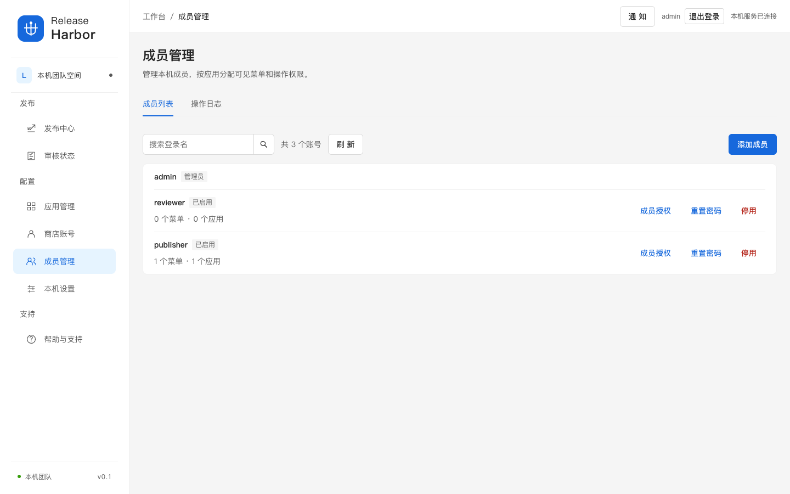

### 2.3 按应用分配权限

1. 在目标成员行点击“成员授权”，勾选“可见菜单”。
2. 按应用名或项目搜索，在对应应用卡勾选需要的操作。每个应用只配置一组操作；新授权覆盖该应用**当前及后续新增的全部渠道**，尚未绑定渠道的应用也可预先授权。
3. 点击“保存权限”。成员刷新或重新聚焦窗口后可看到更新的入口；服务端从下一次请求起使用新权限，后台在开始商店写入前还会复核。已经获得写许可的动作不能靠撤权撤回。
4. 成员登录后在“应用管理”查看分配到的应用。卡片、项目分组与管理员一致；成员不维护应用、渠道、商店账号或本机设置。未显示菜单或按钮时，请管理员同时核对菜单和该应用的操作权限。

| 要让成员做什么     | 管理员如何分配                                             |
| ------------------ | ---------------------------------------------------------- |
| 看应用目录         | 开放“应用管理”，在对应应用卡分配权限；成员只看分配到的应用 |
| 看已缓存的审核状态 | 开放“审核状态”，勾选“查看审核缓存”                         |
| 主动查询和检查资料 | 另勾“查询官方／检查资料”；仍按渠道支持范围显示             |
| 上传包并准备摘要   | 开放“发布中心”，勾选“准备发布／上传包”                     |
| 确认已有摘要并执行 | 开放“发布中心”，另授“确认执行”；可由与准备人不同的成员操作 |
| 核对未知结果       | 额外授予“人工核对”，并从对应执行记录操作                   |

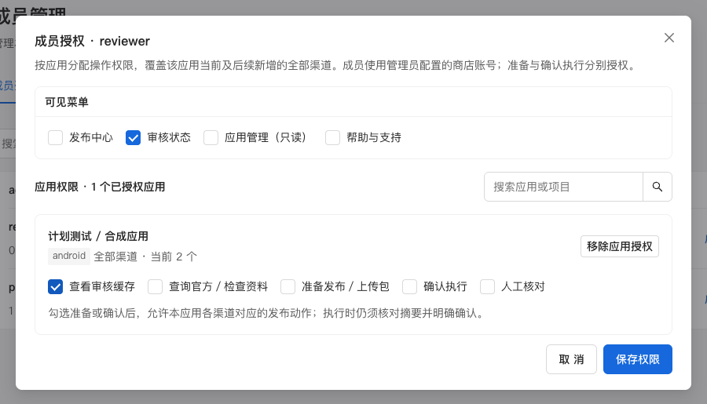

旧渠道授权继续按原范围生效，仅修改菜单不会扩大它。在应用卡重新勾选操作并保存才会替换为覆盖全部渠道的新授权；“移除应用授权”也会移除该应用的旧渠道授权。授权变更不延长摘要有效期、不恢复已用授权，也不解除未知结果或同版本防重。

### 2.4 查看操作日志与发布操作者

1. 管理员进入“成员管理 → 操作日志”，按操作者或目标成员、应用、操作及时间筛选。成员创建、启停、重置密码和授权变更都有记录，日志不记录密码。
2. 对成员操作点“查看变更前后范围”，核对菜单、应用及操作的变化。应用筛选也会匹配授权变更前后的应用范围。
3. 在单渠道摘要、执行详情、批次详情或 Apple 摘要中展开“操作者与操作记录”，查看准备、确认、建立尝试、首次写许可或人工核对所对应的账号。以记录中实际存在的阶段为准；准备和确认可以是不同账号。

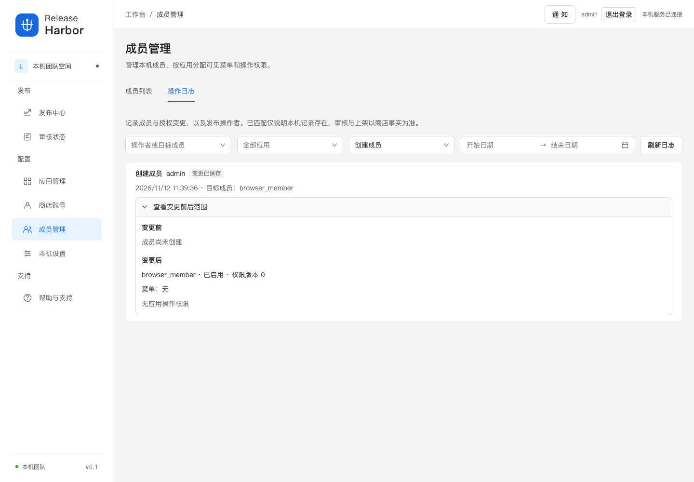

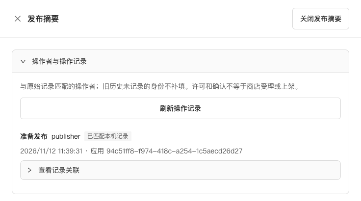

“已匹配本机记录”只表示操作者与该条本机事实关联，商店结果仍看回执及官方状态。“历史未记录”不会用当前登录人补填；“未匹配业务记录”时先核对原业务事实，不据此重新送审。账号、权限和操作日志不随业务备份还原；日志达到 20,000 条或团队文件 16 MiB 的上限会拒绝新增变更和发布阶段，当前无自动归档或删除入口。

## 3. 第一次使用：登记应用与配置账号

### 3.1 新建应用

1. 进入“应用管理 → 新建应用”；首次也可从首页“新建第一个应用”进入。
2. 填写应用名称，选择 Android、iOS 或 HarmonyOS。
3. 填写真实包身份：Android 包名、iOS Bundle ID 或 HarmonyOS 对应身份，不填安装包文件名。
4. 项目仅用于分组，可选已有项目；不选时由向导建立默认分组，不需要源码路径或框架。
5. 点击“保存并配置渠道”，进入下一步。

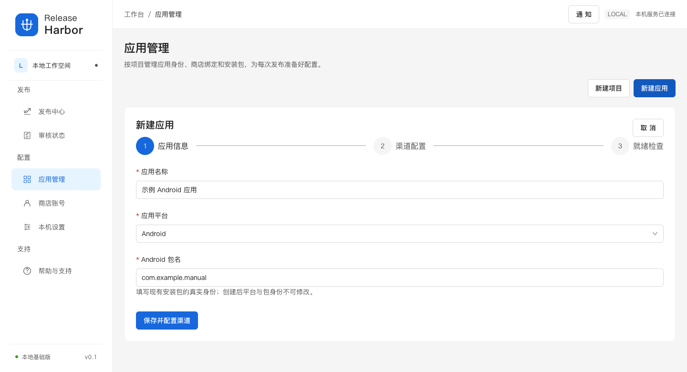

**完成标志：**应用已登记，进入渠道配置。不同平台分别登记身份，不会自动合成一次跨平台发布。

### 3.2 新增商店账号

1. 在渠道配置中新增账号，或进入“商店账号 → 新增商店账号”。
2. 填写便于识别的账号名称，选择商店渠道，点击“下一步”。名称是本机别名。
3. 按向导填材料。例如华为使用 Client ID／Client Secret，Apple 使用 Issuer ID／Key ID／`.p8` 文件；其他渠道以各自向导为准。
4. 继续核对并点击“保存账号”。macOS 钥匙串提示在系统窗口处理。
5. 回绑定表单选择刚保存的账号。

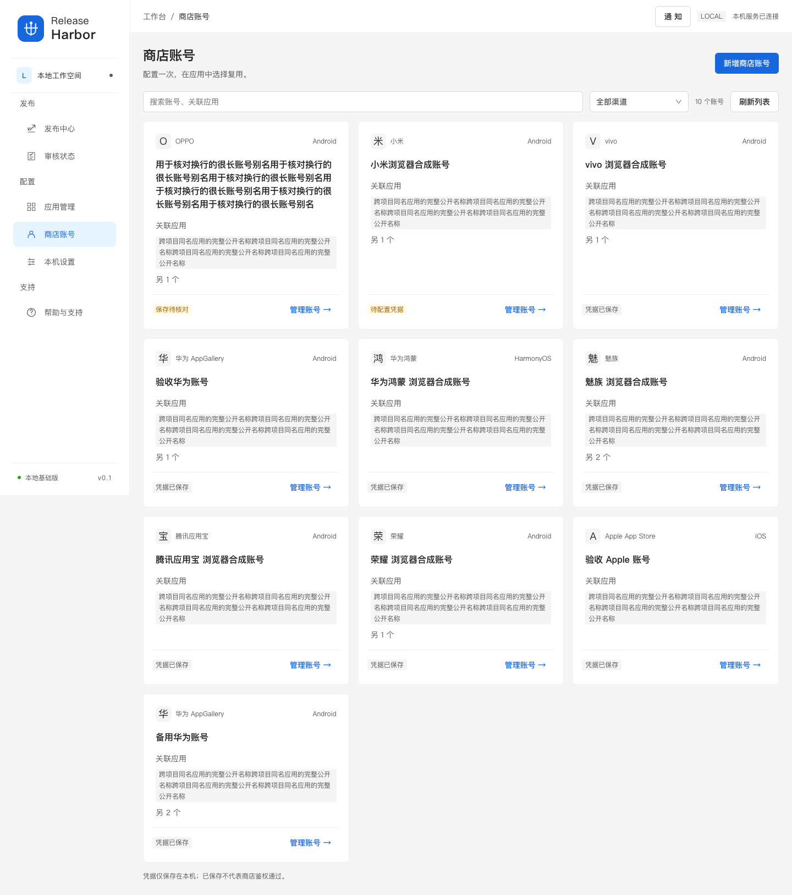

**图 8 定位：**“新增商店账号”创建账号；“管理账号”查看关联、检查本机材料、更新凭据；更多操作中可改名和保护删除。被应用引用的账号须先按界面要求处理关联。

账号材料只在专用向导临时录入。不要将密钥、Token、私钥或测试登录材料写入说明与备注。**“凭据已保存”只证明材料保存，不代表商店鉴权或上传权限通过。**

### 3.3 渠道配置与就绪检查

1. 为应用添加目标商店，核对商店 appId／包名等目标字段，选择对应渠道账号。
2. 保存绑定；同一应用按渠道维护各自目标，不能凭应用名称相似判断。
3. 点击“下一步：就绪检查”。缺渠道则返回补齐；缺安装包可稍后在发布页上传。
4. 完成配置，或满足条件后“开始发布”。后续在应用管理继续维护。

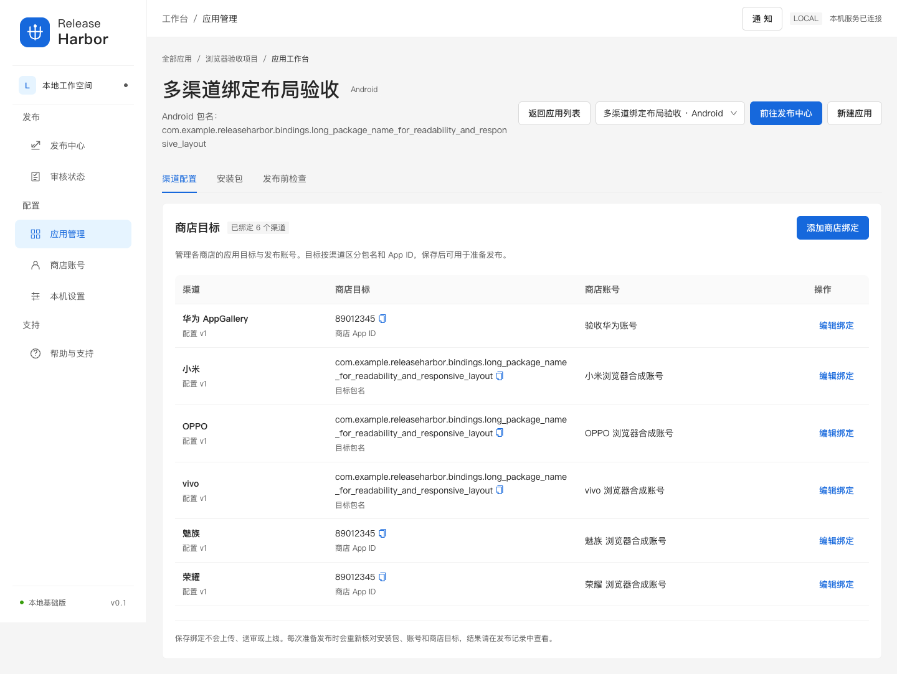

就绪检查只读本机配置。应用中的“发布前检查”可显式进行只读校验；日常点击准备也会自动检查，无需逐个切换入口。这些检查均不授予上传、送审或上线许可。

## 4. 导入和检查安装包

1. 进入“应用管理 → 对应应用 → 安装包”，或在发布表单展开“上传新安装包（可选）”。
2. 选择已有 APK、IPA 或正式 HarmonyOS APP，点击“上传并检查”。
3. 等待“检查通过”，核对平台、包身份、版本名、构建号、大小和 SHA-256。
4. 回发布表单，在“发布安装包”明确选中该文件。已上传不代表已用于本次发布。

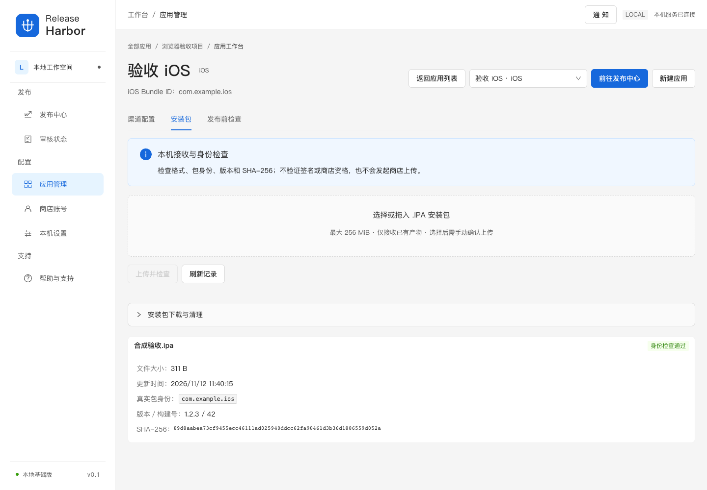

**完成标志：**文件检查通过且身份与应用一致。检查只证明实际字节和识别身份一致，不证明签名、上传权限或送审资格。

单文件最大 256 MiB，本机原文件预算 2 GiB。APK 需 aapt／aapt2，IPA 需 unzip 与 plutil，HarmonyOS APP 需 unzip。缺工具先到运行诊断处理，不反复上传。

发布页上传完成会保留说明与策略草稿。站内暂时离开后回到同一表单，可恢复本次页面会话中的公开草稿；刷新或关闭页面前请留意浏览器提示，未保存的表单草稿不会随短链接恢复。团队退出或切换账号时也会清除草稿。

## 5. 日常单渠道发布

### 5.1 填写发布内容

1. “发布中心 → 发起发布”，选择应用，点击“开始配置”。
2. 在“本次发布渠道”选择一家商店，点击“继续填写发布内容”。
3. 核对应用和平台，选择安装包，填写更新说明与发布策略。
4. 华为 Android 如需正式送审，必须明确选择提交审核；默认为保存草稿。其他渠道以页面显示的真实动作为准。

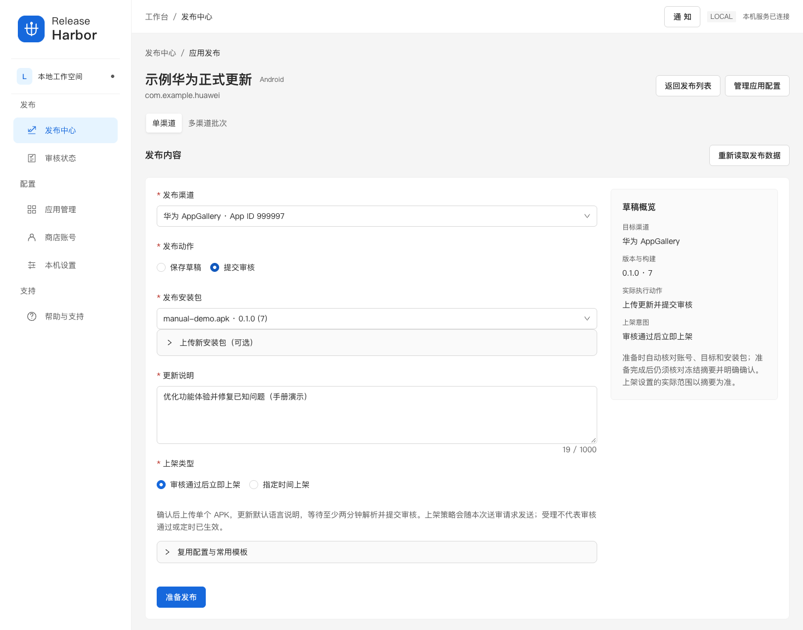

**图 11 定位：**安装包和更新说明属于当前草稿，侧边概览用于检查填写情况；最终动作和授权以准备后的固定摘要为准。

### 5.2 准备、核对摘要、确认一次

1. 点击“准备发布”或当前动作的准备按钮。系统只读检查并生成摘要，此时不上传、不送审。
2. 失败时阅读具体原因，处理资料缺失、在审冲突或来源变化，再重新准备。
3. 核对摘要中的应用身份、商店目标、账号、文件／摘要、版本、真实动作、说明、资料写入范围、语种与策略。
4. 无误后勾选授权说明，再点击摘要中的确认执行按钮。按钮随草稿、送审等动作变化。
5. 保持本机服务运行，查看进度与回执。关闭摘要不授权；更改包、说明或策略须重新准备。

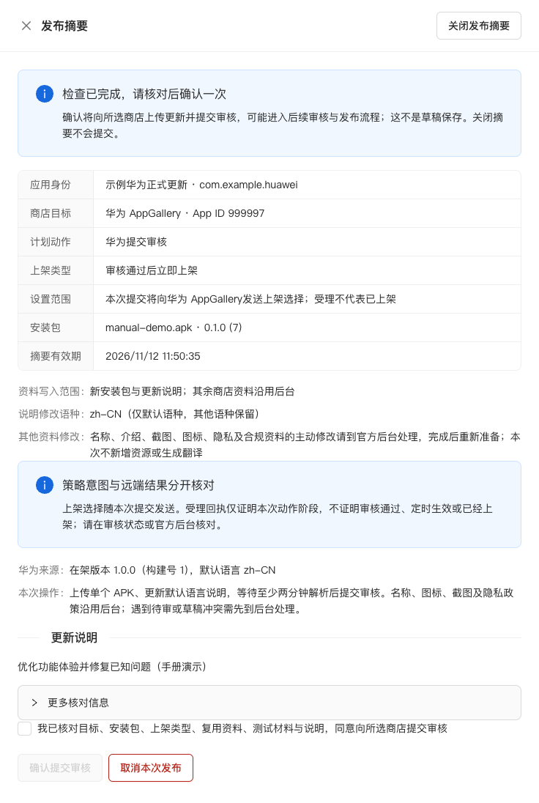

**图 12 阅读顺序：**先看目标与动作，再看安装包、资料范围与策略，最后阅读确认区。插图没有替你授权任何实际发布。

摘要确认通常受五分钟有效期限制，以页面截止时间为准。过期后重新准备；指定时间必须仍在未来，到期不会自动切换为立即上架。

团队分工时，准备人员生成摘要后，告知确认人员应用、渠道和版本。确认人员在自己的会话中进入“发布中心 → 待确认”，找到对应记录并核对同一份摘要，再按授权确认。复制菜单短链接不会带上这条记录。

### 5.3 各渠道的策略与差异

| 渠道／动作   | 策略与关键差异                                             |
| ------------ | ---------------------------------------------------------- |
| 华为 Android | 单渠道可草稿或显式正式送审；批次仅草稿。草稿策略只记录意图 |
| 小米         | 已有应用更新；立即／指定时间；日常上架资料从公开版本复用   |
| OPPO         | 立即／指定时间；上传、异步版本处理与审核分别看             |
| vivo         | 立即／指定时间；更新受理不代表审核通过                     |
| 魅族         | 仅立即意图；当前公开 API 无定时字段，明确拒绝定时          |
| 荣耀         | 立即／指定时间；摘要核对默认语言说明                       |
| 应用宝       | 立即／指定时间；审核结果可能仅应用级，无新包版本归属       |
| 华为鸿蒙     | 独立 HarmonyOS 应用、正式 APP；立即／指定时间              |
| Apple        | 本项目仅审核后自动／手动发布；上传、审核、手动发布分别执行 |

指定时间是审核后的上架意图，不是预约到点才上传。立即方式也需先审核通过。OPPO／vivo 无时区字段按 Asia/Shanghai 映射，需后台核对实际效果。Apple 官方有定时能力，本项目当前不开放。

日常主要更新包与说明，部分渠道会按接口要求重新提交复用字段。“沿用资料”不代表完整图文、隐私和合规均已检查；以摘要范围和语种为准，其他内容到官方后台维护后重新准备。

### 5.4 读懂结果

| 结果                   | 能证明什么                   | 下一步                           |
| ---------------------- | ---------------------------- | -------------------------------- |
| 草稿已保存             | 商店保存草稿                 | 正式送审另行明确选择             |
| 上传已接收／构建处理中 | 文件接收或处理阶段           | 等待可用；iOS 另行送审           |
| OPPO 版本处理成功      | 对应异步版本任务处理成功     | 查询审核状态                     |
| vivo 更新已接收        | 更新请求受理                 | 跟进审核及上架                   |
| 已提交审核             | 提交受理或核对到对应在审版本 | 审核和可下载状态独立核对         |
| 手动发布请求已受理     | 请求发布已批准版本           | 查询实际上架                     |
| 结果待核对             | 写入后结果不明或回执不匹配   | 先后台核对，再登记原执行人工结论 |

“执行完成”是本机操作终态，不等于审核通过或上架。同商店目标的已受理版本受防重复保护，新包摘要、新计划或新批次不能绕过；未知执行结果先按第 12 节处理。

## 6. Android 多渠道批次

适用于同一个 Android 应用的小米、OPPO、vivo、魅族、荣耀、应用宝和华为 Android，每家一个绑定、每项一个 APK。iOS 与 HarmonyOS 不加入该批次。

1. 发起发布，在“本次发布渠道”选择多家，继续进入批次。
2. “批量设置”默认展开。选通用 APK 后会按包版本生成默认说明，可直接编辑；手写或主动清空后，换包不会覆盖。点击“应用到 N 个已选渠道”才会把通用包、说明和策略写入已选行，也可逐行编辑。
3. 再逐行核对。同批版本名称须相同，构建号可以不同。新选渠道不自动继承已应用的通用值。编辑已指定时间的渠道时会回填该渠道的时间，只改说明时会保留；改为立即上架会清除旧时间。
4. 点击“准备 N 个渠道”。部分失败不会自动排除，须修正或明确取消该项后重新准备。
5. 全部准备好后核对渠道集合、顺序、目标、账号、版本、范围、动作和策略，再勾选确认执行。
6. 分别阅读每项回执，不能用批次总状态代替逐渠道结果。

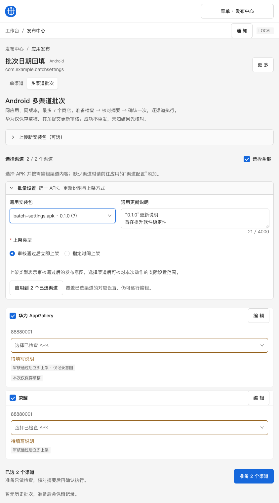

华为项只保存草稿，魅族不支持定时。全局串行，一次一个写操作。摘要五分钟内确认；确认后各项开始写入窗口固定一小时，临执行仍需复核，不自动延长。

“停止后续执行”只取消尚未获得写许可的项，不能撤回已经开始的远端操作。服务重启不续跑旧队列。“重新准备剩余项”时成功及待核对渠道默认不勾选；未知先核对，受理的同版本不重复补发。若响应中断，先刷新查看已保存记录。批次目前隐藏“重新读取批次”“新建批次”和“复用配置与常用模板”；发起新批次请回发布中心。

## 7. iOS：上传、审核与手动发布

### 7.1 上传新 IPA

1. 发起 iOS 应用发布，选择 Apple 渠道进入上传构建流程。
2. 选择检查通过的 IPA，填写内容并准备。
3. 核对摘要的 App ID、Bundle ID、版本及构建号，明确确认上传。
4. 等待上传与构建处理；上传接收不代表送审。

上传中的说明和策略只保存意图，不同步商店版本。已有相同版本和构建时优先复用，不为审核再次传 IPA。

### 7.2 已有构建送审

1. 在 iOS 发布工作区进入“审核与发布”。
2. 选择 Apple 绑定，显式点击“刷新 Apple 构建与状态”。
3. 选择 VALID、未过期的构建及相同营销版本的商店版本。
4. 选择提交审核，填更新说明，选择审核后自动或手动发布。
5. “准备 Apple 审核”，核对摘要的构建、版本、语种、说明和方式，确认提交。
6. 到审核状态查看官方结果。自动发布也需继续确认最终在架。

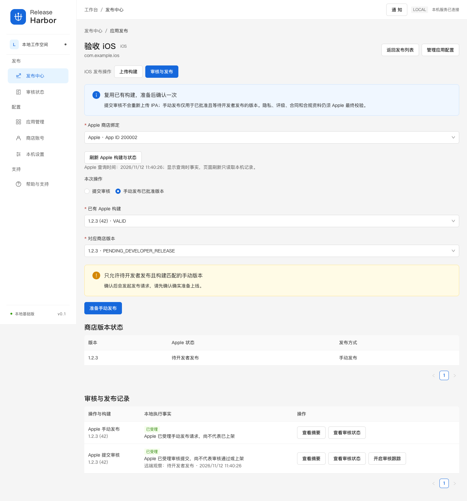

没有对应版本时，先到 App Store Connect 创建相同营销版本并完善资料，再刷新。未完成审核集合、资料缺失或版本已在审时先处理后台冲突；工作台不自动创建版本、撤审或补齐完整合规。同一说明写入摘要列出的现有语种，不自动翻译。

### 7.3 批准后手动发布

1. 确认 Apple 为 `PENDING_DEVELOPER_RELEASE`（等待开发者发布），原策略为手动。
2. 在审核与发布刷新，选一致版本／构建，选择“手动发布已批准版本”。
3. “准备手动发布”，重新阅读摘要并确认请求。
4. 请求受理后继续查询实际上架；请求不能由本工作台撤销。

`PENDING_APPLE_RELEASE` 是等待商店发布，与等待开发者操作不同。上传、审核提交及手动发布分别保留记录和确认。

## 8. 查询审核与上架状态

### 8.1 按绑定直接查官方

1. 进入“审核状态 → 商店状态”；不要求先在本机发布，官网手动提交的版本也可查。
2. 筛选项目、应用、渠道，打开对应详情。
3. 明确点击“查询商店状态”，完成后核对来源、版本、构建、状态和查询时间。
4. 区分当前流程、在架旧版与历史，不用旧上架证明新版本通过。
5. 展开“查询与变化记录”看历史；导航、刷新、筛选、翻页均只读缓存。

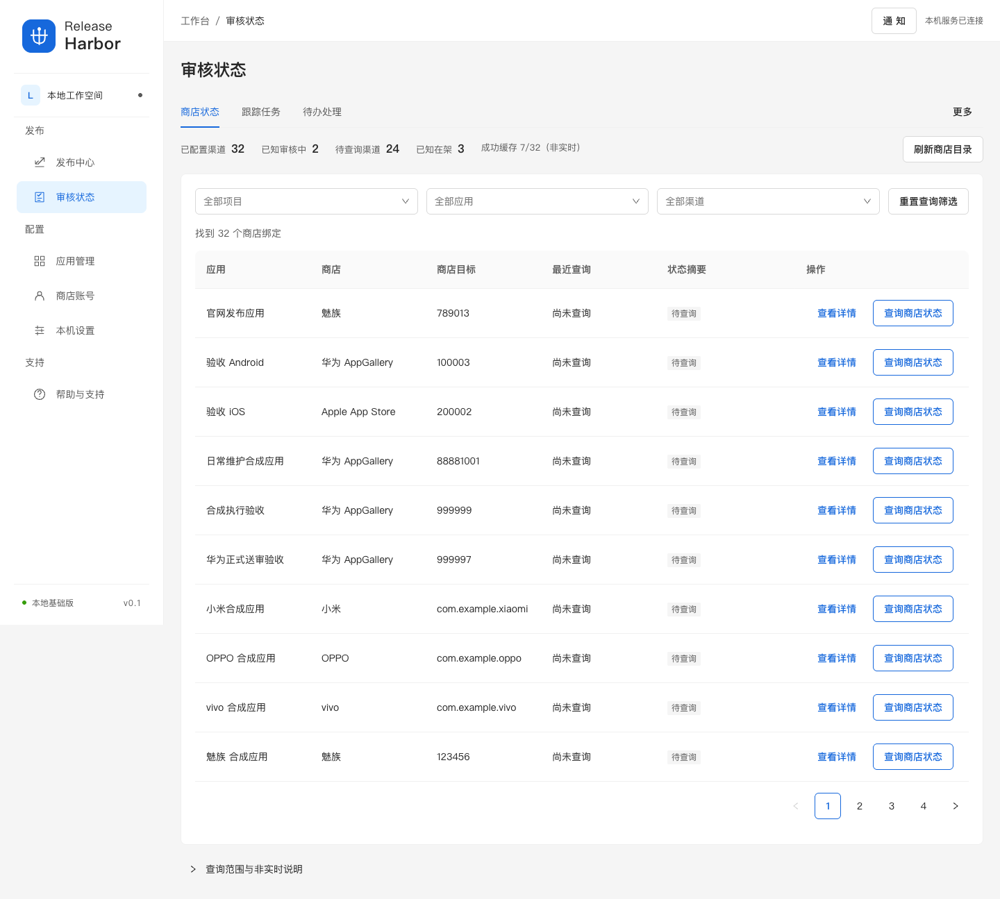

刷新目录不请求商店。结果为带时间的非实时观察。查询失败保留上次成功及原时间作参考，不冒充本次成功；失败、未知、审核拒绝分别处理。每绑定最多保留最近三十次查询，是有界缓存而非永久审计档案。

### 8.2 各渠道查询精度

| 渠道               | 注意事项                                                       |
| ------------------ | -------------------------------------------------------------- |
| 小米               | 仅公开在架，不提供新版本审核进度；可追加带来源／时间的人工核对 |
| 应用宝             | 审核可能无版本标识，只能当应用级事实，不能证明新包通过         |
| OPPO               | 可在详情按正整数构建号查询，响应必须匹配指定构建               |
| 魅族               | 无独立构建号；旧执行缺锚点不能猜关联，官方目录仍可查           |
| 荣耀               | 当前审核与旧在架分开；原执行精确关联取决于保存的审核单         |
| 华为 Android／鸿蒙 | 当前流程、旧在架分别核对，平台身份不能混用                     |
| vivo               | 按官方阶段读，不把更新受理当在架                               |
| Apple              | 商店版本及关联构建，区分审核、待开发者／待商店发布             |

“更多 → 本地发布关联”是辅助历史入口，不是官方查询前提。查询或状态页人工记录不改写原回执，也不解除未知执行保护。

### 8.3 资料检查

支持的渠道详情可展开资料检查。Apple／魅族选择明确商店版本，点击“检查所选版本资料”；其他渠道按查询响应呈现有限状态。按已读取、缺失、未检查／未确认判断，完整意见、附件及整改仍到官方后台处理。

检查只读，不送审。字段有值不证明测试账号能登录、截图合规或全部资格满足。后台处理后回发布中心重新准备。

## 9. 自动跟踪、待办与通知

团队模式下，自动跟踪和本机通知设置由管理员维护。普通成员按已授予的审核权限读取缓存或主动查询。

### 9.1 显式开启只读跟踪

1. 在商店状态打开绑定详情，展开自动跟踪设置。
2. 按渠道支持范围选版本或应用级观察。
3. 选择 15／30／60 分钟间隔，选跟踪到审核结果或继续到确认上架；默认七天到期。
4. 明确开启后，到“审核状态 → 跟踪任务”查任务与下次时间。
5. 按需暂停、继续或结束；账号／绑定变化后按提示重新核对。

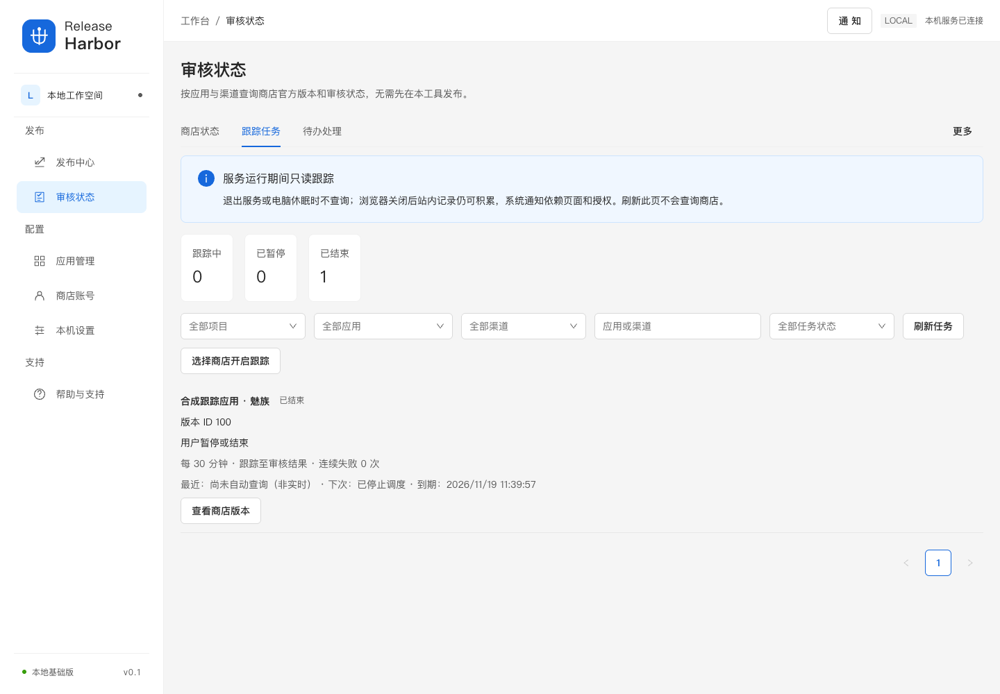

服务退出或电脑休眠时不执行。连续失败三次暂停，账号／权限问题先处理。跟踪仅查询，不上传、送审或上线；小米与应用宝仍有第 8.2 节的精度限制。

### 9.2 待办与通知

“审核状态 → 待办处理”整理审核需处理、待手动发布、查询失败、需后台核对和资料待完善。没有待办只表示当前记录无匹配事项，不表示所有商店通过。

右上角通知入口查看站内记录，已读只改变提醒状态。需要系统通知时，进入“本机设置 → 通知设置”，开启浏览器通知并授权，可选择是否显示应用名。运行诊断可发送测试通知，仍须查看系统通知中心与勿扰状态。

浏览器通知依赖页面运行与系统权限，不是关闭浏览器后的推送服务。测试通知尝试显示不代表实际投递，也不代表商店发生状态变化。

## 10. 单渠道复用历史配置与常用模板

1. 个人模式或团队管理员可在单渠道发布表单展开“复用配置与常用模板”。团队成员按授权手动填写发布内容。
2. 选历史或模板，“带入所选配置”并确认覆盖；取消会保留草稿。
3. 重新选择安装包；定时偏好重新选未来时刻。
4. 核对说明、渠道、策略，再准备确认。
5. 下次复用可填“发布模板名称”，点击“保存当前配置为模板”。

模板只保存渠道、说明与偏好，不保存产物、具体时间、秘密、检查或授权。按应用和发布方式隔离。当前批次页未开放该入口。保存不会发布，带入不会恢复旧执行资格。

## 11. 备份、恢复与空间维护

### 11.1 创建并下载备份

1. “本机设置 → 备份与恢复”，点击“创建备份”。
2. 成功后从备份记录“下载备份”，另存其他磁盘或受控位置。同盘副本不能防磁盘损坏。
3. 需要时显式开启每日自动备份；服务运行时最多每 24 小时一次，保留最近七份自动副本。手动副本自行清理。

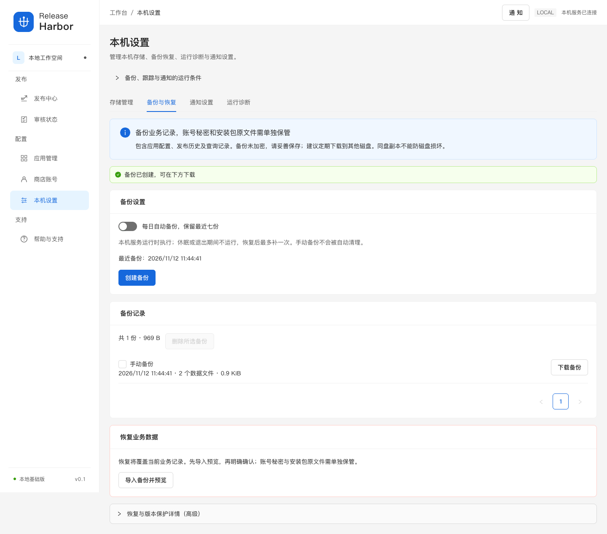

备份最大 32 MiB，未加密，包含名称、说明等业务数据。**不含账号秘密、Keychain／Vault、安装包原文件和原始日志**，不是可直接恢复发版资格的完整机器镜像。

### 11.2 恢复

1. 等待发布、准备、上传、查询、导入、账号配置活动结束。
2. 选择 JSON 文件，阅读预览与覆盖范围，确认选择正确备份。
3. 明确“确认覆盖并恢复”，等待数据代切换、服务短暂重启，再刷新。系统保留恢复前快照。
4. 重新核对商店账号、缺失包与任务。旧发布授权退役、跟踪暂停、自动备份关闭；跨安装恢复只读，不自动获得发布资格。团队账号、权限和操作日志独立保留，服务重启后重新登录。

恢复不删除已受理版本保护，也不解除未知阻塞。校验失败、存储损坏或保护账本缺失时保留现场，不手删 `.local` 或用旧目录覆盖活动数据。

### 11.3 清理空间

1. “本机设置 → 存储管理”，按应用、文件、版本、状态或时间筛选。
2. 需保留的包先下载另存，再选择清理原文件。
3. 阅读确认框中的数量、大小及历史引用，明确确认。
4. 完成后刷新核对；准备、执行或检查中被阻止时，等待活动结束。

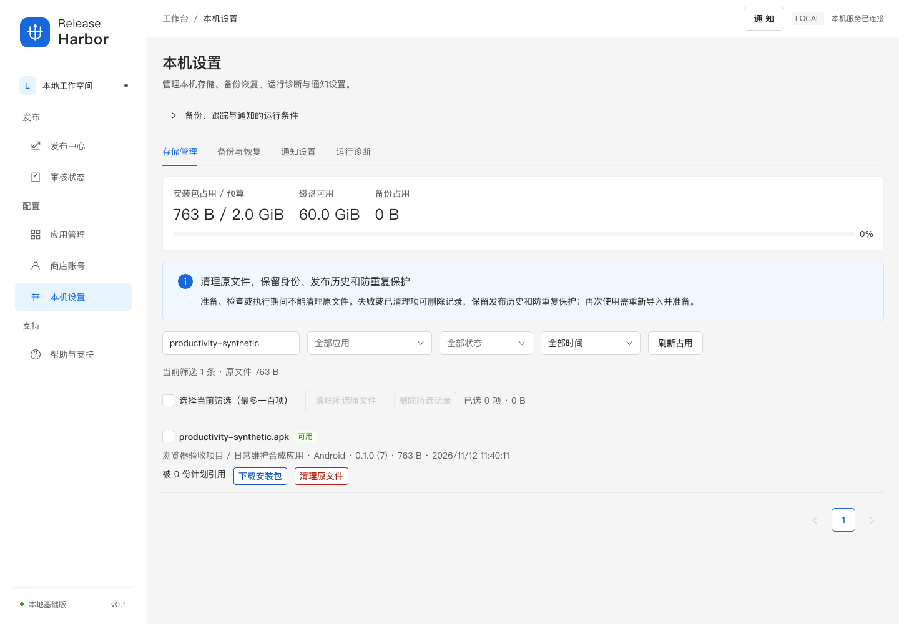

只回收字节，保留身份、摘要、历史与安全保护。旧计划可能失效，再用需重新导入检查及准备。业务备份不能恢复已清理原文件。备份记录也可显式批量删除，不影响已下载到别处的副本。

### 11.4 删除失败或已清理的安装包记录

1. 在“应用管理 → 安装包”或“本机设置 → 存储管理”找到失败、已清理的记录。
2. 点单条“删除记录”，或勾选多条后点“删除所选记录”。确认范围和引用后点“确认删除记录”。
3. 完成后记录从安装包列表移除。原发布快照的包身份、摘要、回执和防重保护仍保留；再次使用须重新导入、检查和准备。

可用、接收中或检查中的记录不能直接删除。删除失败／已清理记录与“清理原文件”是不同操作：其他安装包的上传、检查或发布不阻止删除这类记录；备份、恢复等独占维护期间请稍后再操作。

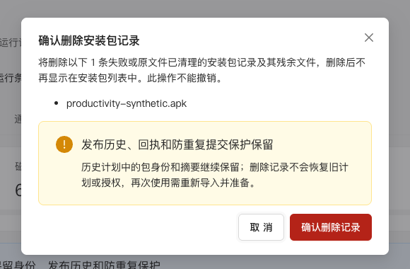

### 11.5 运行诊断

“本机设置 → 运行诊断”查看服务、恢复保护、容量、工具、备份和任务，并按提示处理。默认数据目录 `~/.release-harbor`，不手动移动活动业务代或删除保护文件。

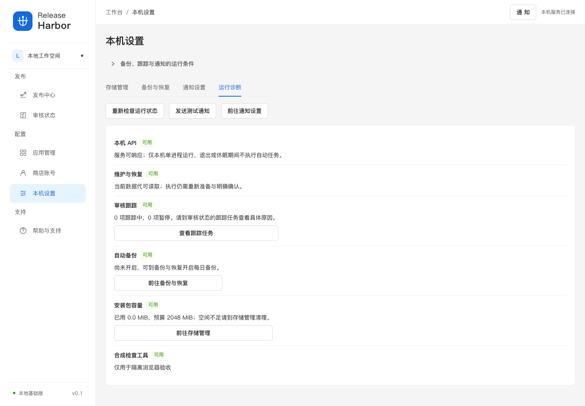

## 12. 异常处理速查

| 现象                   | 处理步骤                                                                       | 判断边界                   |
| ---------------------- | ------------------------------------------------------------------------------ | -------------------------- |
| 启动失败／端口占用     | 阅读终端结果，核对 Node／pnpm／地址，手动处理占用                              | 不自动终止其他程序         |
| 包检查失败             | 核对平台、身份、文件和工具，修正后重新导入                                     | 文件名不证明内容           |
| 保存账号后准备失败     | 检查本机材料、商店接口权限和应用归属                                           | 保存不等于鉴权通过         |
| 摘要过期／绑定变化     | 重新准备并核对新摘要                                                           | 不复用旧授权               |
| 已有草稿／在审冲突     | 官方后台处理流程和资料，再准备                                                 | 不自动撤审或补齐合规       |
| 同版本被阻止           | 查原受理记录，实际更新使用合法新版本／构建                                     | 改包摘要不绕过防重         |
| 结果待核对／上传后断网 | 原执行详情保留回执，到后台核对同目标、版本、构建、文件及处理中任务，再登记结论 | 超时不代表未执行           |
| 查询失败               | 看固定原因和原时间，修正后显式重查                                             | 不是审核拒绝，旧成功只参考 |
| 查到旧版在架           | 比对版本／构建与当前流程，支持时指定构建查                                     | 不能证明新包通过           |
| 备份／清理被阻止       | 等活动结束，失败后刷新核对实际状态                                             | 不手删文件绕过保护         |
| 无跟踪／通知           | 看暂停／到期、服务／休眠、授权与勿扰状态                                       | 已读不等于事项解决         |

**待核对顺序：**保留回执 → 官方后台核对同一目标与版本 → 原执行详情登记真实结论。确认已存在保留防重；确认不存在且无处理中任务才允许新意图、重新准备确认。状态页普通人工备注不会解除原执行阻塞。

团队登录后找不到菜单或按钮时，先刷新并请管理员核对菜单、应用和动作三个范围。停用、重置密码或服务重启后，用有效账号重新登录。

更多问题见“帮助与支持 → 问题档案”；渠道差异见商店指南。问题已解决不等于某次历史发布已成功。

## 13. 每次发版核对清单

| 阶段   | 需核对事项                                                     |
| ------ | -------------------------------------------------------------- |
| 开始前 | 平台、包身份、商店目标和账号正确，后台资料维护完成             |
| 选包后 | 检查通过，版本／构建合法递增，渠道包正确，无未澄清未知结果     |
| 准备后 | 目标、账号、摘要、真实动作、资料范围、语种、策略符合意图       |
| 确认时 | 摘要与指定时间未过期；草稿／送审、上传／审核／手动发布区分正确 |
| 执行后 | 看逐项回执，未知先核对，不重放授权、不把受理当上架             |
| 跟进时 | 官方查询或限定跟踪，比对版本和查询时间                         |
| 收尾时 | 保存所需业务备份与包，实际登记验收，清理前核对影响             |

工程接入不代表每家商店所有远端场景已验收。真实送审、指定时间生效、最终上架及系统通知投递须按具体版本分别核对。

## 14. 保存 PDF、图片来源与维护说明

用 Chrome 打开同目录的 `user-manual.html`，按 **⌘P**，将目标打印机设为“另存为 PDF”，纸张选 A4、纵向，关闭页眉和页脚，预览后保存。Safari 可从打印窗口底部的“PDF”菜单选择“存储为 PDF”。HTML 的图片已内嵌，无需联网。

图 2–6 来自隔离的团队 Chrome 测试。其他图片来自全站 Chrome 冒烟或同类隔离服务补拍，不读取默认数据目录、不使用真实凭据，也不执行真实商店操作。“验收”“合成”等是演示标识。

Markdown 为内容源；同目录 `user-manual.html` 包含相同章节、目录和内嵌图片，可直接打开、离线阅读或浏览器打印。它是阅读附件，不是工作台新菜单。修改内容或图片后执行：

```bash
node scripts/build-user-manual.mjs
pnpm exec prettier --write docs/guides/user-manual.md docs/guides/user-manual.html
```

进一步阅读：[本机团队指南](local-team.md)、[快速指南](workbench-quick-start.md)、[统一发布指南](release-orchestration.md)、[官方状态查询](release-status-observations.md)、[本机效率](local-efficiency.md)、[日常维护](local-productivity.md)、[真实待验清单](../verification/local-productivity-acceptance-2026-11-08.md)。历史指南的旧入口如有差异，以当前界面及本手册统一发起流程为准。
