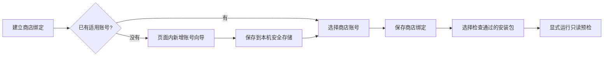
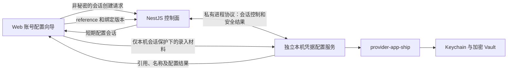

# 页面内商店账号配置向导方案

**日期：**2026-11-03。  
**状态：**用户已选择页面内配置方式；本文件为 P1-3A 的待实施方案，本次仅完成规划。  
**实施位置：**先完成本切片，再进入 P1-4 计划冻结与人工确认。

## 1. 目标与范围

用户在工作台内完成商店账号配置、选择和绑定，不再为了普通配置切换终端、手写凭据引用或刷新目录。沿用白色主题和 Ant Design，继续复用现有 Keychain、加密 Vault、商店绑定及只读预检。

首轮支持当前本地 macOS 环境下的华为 Client ID／Client Secret，以及 Apple 团队 API Key 的 Issuer ID／Key ID／`.p8` 私钥。保存只检查格式和存储结果；真实鉴权、应用目标匹配及产物核验仍由用户显式运行只读预检。保存账号不代表上传权限或发布授权。

本轮不增加凭据回显／导出、已有材料原地覆盖、删除、自动轮换、商店登录抓取或自动发布。CLI 继续作为维护入口，正常页面流程不依赖它。Windows／Linux 安全存储及在线控制台录入另行规划，不使用明文文件降级。

## 2. 用户主流程

### 2.1 商店绑定

- 保留商店 appId，并将“凭据引用”输入框改为“商店账号”Select；选项按渠道筛选，展示账号名称和配置状态。
- 没有账号时展示“尚无华为／Apple 账号”和“新增账号”按钮；不让用户猜测内部别名。
- 从绑定页打开向导时锁定当前渠道，保留尚未保存的 appId 与绑定 revision；取消向导后返回原表单。
- 新建成功后自动重新读取目录并选中新账号，仅更新当前仍打开、仍属于原应用的表单；应用切换后的旧回调不能修改新页面。
- 保存账号不会同时保存绑定；向导完成后回到绑定表单，用户点击“保存绑定”。若绑定存在版本冲突，保留公开草稿并按现有规则显式核对。
- 一个已配置账号可以被同渠道的多个应用引用；每个应用的商店目标及预检结果分别核对，不能共享一个全局“已验证”标志。

### 2.2 新增账号向导

采用 Ant Design Drawer + Steps + Form。桌面右侧展开，窄屏占满可用宽度；不叠加第二个 Drawer。明确关闭、返回、保存及键盘焦点恢复，保存中阻止重复提交。

| 步骤     | 页面内容                                   | 规则                                                                                                 |
| -------- | ------------------------------------------ | ---------------------------------------------------------------------------------------------------- |
| 账号信息 | 渠道、账号名称，例如“华为 · 公司发布账号”  | 名称 1～60 个字符，同渠道内避免重名；内部 reference 由本机服务生成，用户不用填写。                   |
| 配置材料 | 按渠道展示字段、官方获取说明和文件选择     | 华为输入 Client ID／Client Secret；Apple 输入团队 Issuer ID／Key ID 并选择 `.p8`，不填写服务器路径。 |
| 确认保存 | 账号名称、渠道、存储位置说明及材料是否齐全 | 不回显秘密正文；按钮为“保存账号”，不使用“授权成功”或“保存并发布”。                                   |

首次录入提示“凭据将保存在本机安全存储，页面仅在录入期间临时处理”。秘密字段使用 Input.Password，默认隐藏；步骤间允许返回修改，但关闭、保存完成和页面卸载都清理秘密字段、文件对象和组件状态。公开的账号名称、绑定 appId 可以保留，秘密不得作为失败草稿持久化。

前端格式校验减少误填，本机服务独立验证全部字段、渠道和大小。Apple 文件上限沿用 64 KiB，服务端验证有效 P-256 私钥；请求整体上限初定 128 KiB。失败消息只返回固定分类，不带私钥、请求正文、本机路径或 SDK 原文。

### 2.3 商店账号管理入口

导航增加“商店账号”，提供列表、渠道筛选、新增和安全信息查看。显示账号名称、渠道、是否配置、环境／目录状态及关联应用数量；目录可读不代表秘密已成功解密或商店鉴权通过。不提供已保存 Client Secret、Issuer ID、私钥正文或密码的读取接口。

“账号名称”是用户为凭据档案设置的标签，不是商店登录名，也不是项目标识或 appId。普通界面隐藏 reference；诊断详情可以展示其公开值以兼容 CLI。

目录刷新在保存回调、页面重新进入及预检提交前发生；保留“重新读取”作为失败恢复按钮，正常成功路径无需手动刷新。

## 3. 安全边界调整

原设计禁止 Web 接收秘密，只允许 CLI 录入。页面向导必然让浏览器在输入期间接触明文，因此不能继续声称“凭据从不经过网页”。本方案把例外限定在本地账号录入模块，不开放秘密查询，也不让商店业务 API 接收材料。

### 3.1 本机凭据配置服务

- 由本地启动流程自动管理一个独立可信 Node 进程，可放在 `packages/runner-local`；固定使用仓库入口，不接受页面指定命令、SDK、服务地址或存储根。
- 配置进程在 `127.0.0.1` 的系统分配端口监听，直接接收浏览器材料并调用 provider；业务 API 不代理、解析、落盘或记录该请求正文。
- 控制面仅通过私有进程协议创建配置会话、查询安全结果及读取账号目录；SDK 与解密材料不进入 NestJS、domain 或公共 contracts。
- 浏览器只接受本次本地启动实例返回并验证的回环端点；不能使用用户输入地址或让服务重定向录入请求。`pnpm dev` 和本地构建启动都自动启动配置进程，不要求用户再开命令。
- 停止服务不自动重放保存请求；启动恢复先核对安全元数据和操作记录。

### 3.2 会话、来源与浏览器内存

Host／Origin 校验必须补充会话保护，不能仅因端口位于 localhost 就接受写入。会话策略为本项目设计取舍，参考 [OWASP 的来源校验与自定义请求头建议](https://cheatsheetseries.owasp.org/cheatsheets/Cross-Site_Request_Forgery_Prevention_Cheat_Sheet.html)。

1. 用户点击新增时创建 5 分钟有效的配置会话，固定渠道、可信 local 工作空间、操作 ID、预分配 reference、允许的 Web Origin 和当前启动实例。会话令牌使用至少 256 位随机值。
2. 创建会话入口要求 JSON、自定义请求头及精确的可信来源，拒绝无法确认来源和 `Origin: null` 的请求；不沿用现有业务 API 对缺失 Origin 的宽松规则。
3. 材料直接提交配置服务，使用 Authorization 请求头；令牌仅保存在向导内存，不放 URL、Cookie、日志、浏览器存储或通用查询缓存。
4. 配置服务严格校验 Host、Origin、会话、渠道、操作 ID、类型和大小；CORS 仅允许本次实例的精确工作台来源及必要方法／请求头，不使用通配符。请求使用 `credentials: omit`，不依赖跨站 Cookie。
5. 一个会话只允许启动一次保存；同操作的重复请求只能查询原结果，不能再次写入。到期后拒绝新的保存，不因过期自动中断已开始的 Keychain 写入。
6. 材料和会话响应使用 `Cache-Control: no-store`；录入模块不接入请求正文日志、埋点、错误快照或 Service Worker 缓存，不经通用 API 错误对象传播秘密。
7. 仅组件内存持有输入；退出时清理引用，不承诺 JavaScript 字符串可被可靠物理清零。本机录入仍信任当前浏览器与设备，不能把会话令牌当成线上身份认证或对本机恶意程序的隔离。

macOS 可能显示系统 Keychain 授权窗口。页面应明确显示正在保存及完成系统提示的说明，但不能在无法检测真实系统状态时编造“正在等待授权”。用户无需为材料录入切到终端。

### 3.3 合同与规范落点

| 位置                                 | 待实施调整                                                                             |
| ------------------------------------ | -------------------------------------------------------------------------------------- |
| `apps/web`                           | 增加局部敏感录入模块及专用传输适配；普通绑定、列表、预检仍只处理安全元数据。           |
| `packages/contracts`                 | 只增加商店账号的安全元数据，不放材料字段、会话令牌或执行器文件路径。                   |
| `apps/api`                           | 只处理会话控制及安全目录；不新增接收 Client Secret／私钥的业务 Controller。            |
| `packages/runner-local`              | 增加配置服务宿主、带版本的私有控制协议、会话及操作状态。                               |
| `packages/provider-app-ship`         | 复用并集中适配 SDK 的保存、目录和 Keychain／Vault 能力。                               |
| `AGENTS.md`、前端规范、架构与 README | 实施时同步增加“本地账号录入模块”的限定例外；本次方案不把现有代码描述成已支持网页录入。 |

敏感传输类型限定在 Web 的账号录入适配和配置服务的私有协议中，双方独立执行运行时验证；不能为省事把整个材料对象移入公共 contracts。私有父子协议包含 schemaVersion、会话／操作关联及安全投影，进程原始输出不能作为结果。

## 4. 数据与接口设计

### 4.1 安全账号元数据

公开目录扩展为账号标签与现有 Profile 的组合：reference、displayName、channel、configured、revision、环境／目录状态。应用关联数量从绑定关系计算，不在两处维护计数。

新账号名称在本机写队列内按可信工作空间及渠道保护唯一性，不能只靠前端查重；旧档案回退名称出现歧义时追加公开引用后缀，不自动改写档案或替换绑定。

reference 由服务端生成，例如 `profile-` 加随机 UUID，保持现有引用格式，创建后不改名。名称与非秘密保存操作记录保存在本机独立的版本化元数据文件，例如 `credential-accounts.json`；SDK 的 `credentials/profiles.json` 继续管理真实材料及安全配置事实，不私自扩展第三方文件格式。

### 4.2 拟议接口

以下是待实现接口，不代表当前服务已经开放。

| 接收方       | 接口                                          | 输入／返回边界                                                                                |
| ------------ | --------------------------------------------- | --------------------------------------------------------------------------------------------- |
| 控制面       | `GET /api/credential-accounts`                | 返回当前可信 local 工作空间的安全账号目录；允许按渠道查询。                                   |
| 控制面       | `POST /api/local-credential-sessions`         | 输入仅含渠道；通过可信进程取得本机端点、会话 ID、操作 ID、短期令牌和到期时间，返回 no-store。 |
| 本机配置服务 | `POST /v1/sessions/:sessionId/profile`        | 接收会话保护下的账号名称和该渠道材料；受理后返回操作状态，不返回材料。                        |
| 本机配置服务 | `GET /v1/sessions/:sessionId/operation`       | 需会话令牌，只返回该操作的安全状态与 reference。                                              |
| 本机配置服务 | `DELETE /v1/sessions/:sessionId`              | 仅能取消尚未开始的配置会话；已经开始保存时明确返回“正在保存”，不谎称已撤销。                  |
| 控制面       | `GET /api/credential-operations/:operationId` | 从受信任本机进程取得安全结果，用于超时／刷新后的核对；ID 本身不是权限，仍校验可信归属。       |

会话接口的敏感响应使用独立的局部传输解码，不并入可公开持久化合同。保存格式采用渠道判别联合与字段白名单：华为只有 clientId／clientSecret，Apple 只有 apiIssuerId／apiKeyId／privateKey 内容；不接收账号 JSON、任意渠道、服务器路径或客户端指定 reference。

现有 `/api/profiles` 和 `ChannelBinding.credentialReference` 保持兼容；界面名称变化不重写已保存应用和绑定。预检继续使用当前归属、版本及摘要合同。

## 5. 保存、中断与错误恢复

保存状态区分 open、saving、saved、failed、needs_reconciliation、expired、cancelled。保存结果与商店预检结果分别存储，保存成功的显示文案为“账号已配置，尚未进行应用预检”。

1. 保存前校验会话和输入，生成稳定的操作 ID／reference；原子写入仅含名称、渠道、操作关联和状态的意图记录，秘密不进入记录。
2. 配置进程通过 provider 调用 SDK 保存；复用 Keychain service `release-harbor` 和现有加密 Vault，不静默覆盖已有引用。SDK 写锁与目录版本规则继续生效；多入口冲突明确返回，页面不自动重试秘密请求。
3. 保存结束后重新读取 SDK 安全元数据，核对引用与渠道，再原子标记操作结果。SDK 文件与账号标签文件没有跨文件事务，不能声称同时原子提交。
4. 请求超时或保存后回包丢失，页面先查询同一操作，不生成新引用再提交。元数据已确认材料保存时显示已保存；仅标签落盘失败时保留 reference 作为名称兜底，明确提示标签待恢复。
5. 进程重启后仅根据已记录 reference 与 SDK 元数据核对；不能确定 Keychain／Vault 是否一致时保留 needs_reconciliation，停止该档案的可用判定并引导人工检查，不自动解密、覆写或重新保存。

取消发生在提交前时清理输入和会话，没有保存副作用。已经进入 saving 后，关闭向导只停止页面等待；页面提示保存可能仍在继续，并提供从账号列表查看结果的入口。绑定失败不会反向删除已保存账号，也不会自动绑定到另一个目标。

材料校验失败可在当前打开的向导中修改后重试；若已进入保存且结果不明，只允许查询和核对。关闭页面后再次录入需要重新填写秘密，不从本地存储恢复。

## 6. 兼容与现有预检

- 旧 CLI 档案继续列出，缺少 displayName 时使用原公开引用作为名称，标记为“已有档案”；不要求重录秘密或修改已有绑定。
- 旧绑定中的引用不存在／渠道不符时，明确展示问题并要求用户选择或新增账号；禁止自动选择列表第一项。
- 新增材料继续改变现有 Vault 版本，保守地使历史预检失效；不能把目录刷新当作重新鉴权。
- 账号名称及标签修复不改材料、不改 reference，不因纯标签变化更新绑定 revision 或伪造新的预检事实。
- 预检仍要求保存后的绑定、ready 产物及其当前版本。保存账号不自动查询商店；用户点击“运行只读预检”才发起已有只读请求。
- Apple 首轮只支持当前适配已使用的团队 API Key；不把个人 API Key 或 Apple ID／专用密码伪装成同一种只读方式，不宣称构建上传凭据已齐备。

## 7. 实施顺序与交付

| 步骤            | 交付内容                                                         | 完成条件                                                                 |
| --------------- | ---------------------------------------------------------------- | ------------------------------------------------------------------------ |
| 1：规格与边界   | 本方案、OpenSpec 提案／规格／任务，排在 P1-4 前                  | 本次完成规划；实现任务保持未勾选。                                       |
| 2：本机配置闭环 | 进程宿主、会话、白名单输入、安全存储、幂等操作及元数据读取       | 内存安全库、假 Keychain 故障和隔离 HTTP 测试通过；无真实账号和商店请求。 |
| 3：页面配置闭环 | 商店账号页、华为／Apple Drawer、绑定 Select、保存回填及 CLI 兼容 | 用户完成路径无需终端；秘密不进入普通列表、绑定、历史记录或页面缓存。     |
| 4：恢复与验收   | 超时核对、取消、跨页面竞争、重启及完整浏览器验收                 | 工程检查与合成材料冒烟通过；真实 Keychain 录入和真实商店核验分别记录。   |

每步完成后按项目规则验证并自动提交。此切片交付后继续 P1-4、P1-5，不提前加入自动送审或在线密钥托管。

## 8. 验收清单

- 从新建绑定到新增账号、返回自动选中、保存绑定、选择安装包及显式预检，全程无需终端；手机宽度下同样可完成。
- 必填项、同渠道重名、错误文件、非法私钥、超过大小和不支持环境均给出准确反馈。
- 重复点击、并发窗口、会话到期、跨渠道、错误来源、空来源、未知字段及伪造端点被拒绝。
- 材料仅到达本机配置服务；业务 API、URL、日志、埋点、缓存、公开 JSON、操作记录和非加密文件不含合成秘密标记。
- 保存中断／回包丢失可查询同一次操作，不能出现重复档案、误报已取消或伪造保存成功。
- 旧 CLI 账号、失效绑定、历史预检、绑定版本冲突和应用切换回调有可重复验证的行为。
- 执行 `pnpm typecheck`、`pnpm test`、`pnpm build`、`pnpm format:check`；页面实现后执行真实浏览器冒烟。真实安全存储录入与商店验收单独记录，替身测试不替代它们。

## 9. 官方字段说明来源

- [华为 AppGallery Connect API 应用集成准备](https://developer.huawei.com/consumer/cn/codelab/AGCPreparation-connectapi/)：参考其中 API 客户端的创建和 ID／密钥获取说明；不把应用内 SDK 配置中的同名字段直接当作发布账号。
- [Apple 创建 App Store Connect API Key](https://developer.apple.com/documentation/AppStoreConnectAPI/creating-api-keys-for-app-store-connect-api)：向导首轮明确使用团队密钥；帮助说明密钥标识及私钥来源，不代用户申请或扩大商店权限。

帮助入口随官方界面变化维护，链接使用固定官方域名；真实账号仍需用户自行取得相应材料。
