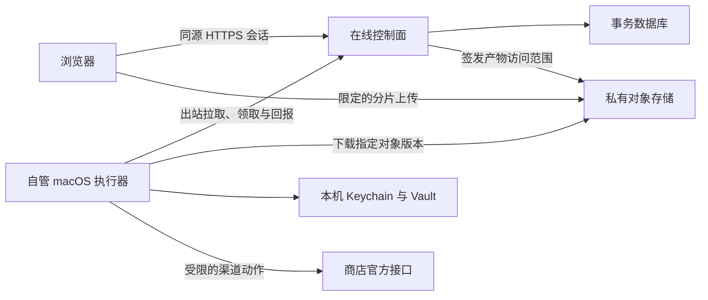

# 第五期：在线控制台规划

状态：2026-11-11 开始规划，待确认实施范围。本文不代表 hosted 模式已启用、试点已部署或真实商店已验收。

## 1. 首版目标

建议先做**邀请制在线工作台 + 自管 macOS 执行器**。成员在浏览器登录，进入授权工作空间，上传已有 APK。执行器主动领取检查和预检任务；操作者核对摘要、明确确认一次后，由同一执行器保存华为 Android 草稿。控制台展示脱敏回执与待核对事项。

选择华为 Android 已有应用的单 APK **保存草稿**（`huawei_save_draft`）作为试点：已有本机端的后台核对反馈，可以复用现有适配，且不需要借正式送审或上线验证在线架构。在线试点仍须单独验证，不继承本机验收结论。只允许已获准的工作空间、目标及动作；测试环境用替身验证全链路。

- **首版交付**：登录和成员权限、项目／应用／绑定、私有产物、执行器配对和撤销、准备与一次确认、草稿回执及人工核对。保留发布中心和应用管理的基本操作习惯。
- **本期不铺开**：其他渠道、华为正式送审、iOS／鸿蒙、跨端批次、在线凭据录入、自动状态跟踪、本机数据双向同步。第六期再规划团队审批、CI 触发、自动调度和通知。
- **当前边界**：本机入口仍固定 `local`、使用本机文件存储，并拒绝 hosted 装配；现有隧道的来源白名单不提供身份认证。在线装配独立启动，不复用本机无认证路由、凭据向导或本机维护接口。依据：[现行架构](../ARCHITECTURE.md)、[部署说明](../DEPLOYMENT.md)、[第四期交付](../verification/phase-4-completion-2026-11-08.md)。

## 2. 部署与职责

| 位置       | 职责及首版建议                                                                                                                                                                                          |
| ---------- | ------------------------------------------------------------------------------------------------------------------------------------------------------------------------------------------------------- |
| 浏览器     | 登录、切换工作空间、上传产物、准备与确认、查看结果。继续使用公开合同，不接收商店秘密或执行器路径。切换工作空间时清空上一空间缓存、草稿和待完成请求，旧响应不能写入新空间。                              |
| 在线控制面 | 复用 NestJS／Fastify 和既有领域语义。Web 与 API 同源部署；建议接入 OIDC，使用服务端会话、受保护 Cookie 和写请求防跨站机制。服务端基于会话和有效成员关系确定工作空间与权限；请求中的空间 ID 只用于定位。 |
| 数据库     | 建议用 PostgreSQL 持久化成员、配置、任务、计划、授权及审计。租户资源以工作空间复合键关联，所有读写带可信空间范围；数据库事务承担领取、幂等及防重。首版不额外引入 Redis 或消息总线。                     |
| 对象存储   | 建议用私有 S3 兼容存储。浏览器获得受限的短期上传能力，安装包字节直传对象存储，控制面只处理授权和元数据。平台、供应商、区域、预算和留存策略留到 P5-0 比选。                                              |
| 可信执行器 | 首版复用 macOS 的包检查工具、Keychain／Vault 和现有商店 Adapter。执行器以独立设备身份主动拉取，无需开放入站端口。账号在设备本机维护；控制面只接收经过投影的账号引用、能力和材料版本。                   |

首版角色：**管理员**管理工作空间、邀请与撤销成员、应用绑定及执行器；**发布操作员**上传、准备、确认和记录人工核对；**查看者**只读业务记录，不下载安装包。管理员可以执行操作员动作，仍需同一次明确确认。设备身份与成员会话分开；吊销设备不会修改历史回执。成员权限、归属和设备状态在产生副作用前重新检查。

## 3. 必须先钉住的三条合同

### 产物交接

1. 控制面验证成员和应用归属，创建接收记录并在签发上传能力前预留配额。首版候选单件上限沿用 256 MiB；总配额、分片时限和留存天数由 P5-0 定。上传会话固定工作空间、产物 ID 和服务端生成的私有对象位置；终止或过期后释放配额并回收未完成分片。
2. 完成请求只能落到已登记对象；核对实际大小，固化不可覆盖的对象版本，再交给配对执行器检查。浏览器声明的摘要、分片 ETag 和上传成功提示都不能充当身份结果。执行器对固定对象版本重新计算 SHA-256、检查包名／版本／构建号，并在真正执行前再次核对实际字节及冻结摘要。只有检查通过的产物才能准备计划。
3. 下载能力绑定特定对象和用途，签发时重新校验成员或任务租约，签名地址不写日志。已签发的短期地址在到期前可能仍可使用，撤销时阻止新签发，不能承诺撤回既有链接。浏览器分清上传、检查、可用、失败和已清理；刷新只读记录，取消、续传和重新上传均由用户显式触发。

### 配对、一次确认与执行

- **配对**：由管理员创建一次性、短时、限定工作空间的配对邀请；设备在本机完成配对并持有可轮换、可撤销的设备凭据。登记设备版本、能力与安全账号引用，关联分配的应用／绑定。仅心跳在线或存在凭据引用不等于已通过商店预检。
- **准备和确认**：执行器以只读任务核对固定产物、商店真实目标和账号。计划固定工作空间、应用、绑定 revision、真实目标、产物对象版本与摘要、凭据材料版本、执行器、实际动作和资料范围。确认事务核对操作者、计划摘要和预检有效期，创建独立在线授权及唯一 attempt。首次写许可的期限不晚于预检和在线授权期限；离线等待或租约续期不得延长授权。`local_once`、`local_batch_once` 均不能在线兑换。
- **领取与许可**：领取只建立有限期租约；执行器验证协议版本和完整计划，再提交临执行证明。控制面在同一数据库事务中重验成员、设备、租约、摘要、产物、绑定与账号版本、渠道能力及防重保护，消费在线授权并登记唯一首次写许可。设备只有在收到有效许可后才可调用商店写接口；设备本地持久化 attempt 的开始记录，同一许可不重放。首版线上试点全局商店写入并发 1；配对设备断线或变更时不自动迁移已确认任务。
- **结果**：持久化许可前取消、失效或离线，只记未开始，重新准备确认；一旦许可已登记且没有可信终态，即使不能确认设备收到许可，也进入待核对，阻塞同一真实商店目标，不自动重领或重试写入。重复回报可幂等确认，过期或错配回报不得覆盖终态；合法迟到证据按原 attempt 留存，不能触发执行。人工核对追加独立声明；确认已存在保留版本保护，确认不存在才允许重新准备。草稿保存不等于送审或上架。

### 防重、切换与恢复

- 在线依据经核对的商店真实目标和版本／构建维护防重，不能用工作空间内的绑定 ID 或账号别名绕过。试点目标只归一个写入工作空间；冲突不给另一空间披露资源信息。第四期同版本防重和未知结果保护继续适用，不因重打包、换执行器或新计划失效。
- 本机数据与在线数据并存。试点建议使用专用商店目标，由在线环境独占写入；同一个真实目标不能本机和在线同时写。已有本机目标要转入线上时，先冻结本机写入，核对官方目标、版本基线、已受理及未核对记录。第五期未交付可证明安全的迁移时，只允许专用目标；不导入 Keychain、旧授权或备份作为执行资格。
- 备份覆盖数据库和已引用的不可变对象。首次写许可与防重／待核对事实必须在恢复时可独立证明未回退；P5-0 确定持久化和恢复方案，例如许可发出前同步确认独立保护日志。恢复或切回时先关闭商店写入、退役旧授权与租约、核对保护记录和对象；证据不完整就保持只读。停发新许可不撤销已开始的商店操作，须单独核对结果。

## 4. 里程碑与退出条件

| 切片                         | 交付                                                                                                                  | 退出条件                                                                                                                                   |
| ---------------------------- | --------------------------------------------------------------------------------------------------------------------- | ------------------------------------------------------------------------------------------------------------------------------------------ |
| **P5-0：边界与验证基线**     | 写首份 OpenSpec；梳理本机与在线装配、租户权限、产物与任务合同；确定身份、数据库、对象存储、留存、恢复及隔离测试方案。 | 能指出每个写入口的授权来源；明确试点类型、准入标准及非目标；保留本机拒绝 hosted 的回归基线。此切片不开放在线写操作。                       |
| **P5-1：身份、空间与数据库** | 在隔离环境接入登录、成员及角色，交付在线项目、应用和绑定的最小目录；数据库迁移可在空库执行。                          | 至少两个测试空间；跨空间列表、详情、写入、直接资源引用均被拒绝；角色变更与退出生效。匿名请求不落入本机模式；旧本机目录与数据不变。         |
| **P5-2：对象上传**           | 交付配额、分片直传、完成校验、下载权限和清理。无执行器时仅显示待检查。                                                | 用合成数据验证 256 MiB 边界、慢速／中断／续传、错误大小、过期上传、跨空间签发拒绝、对象版本冻结和清理保护。控制面不转发大包。              |
| **P5-3：执行器与只读准备**   | 配对、轮换／撤销、能力、任务租约、身份检查、只读预检及不可变计划。先打通不发商店写请求的链路。                        | 跨空间或已撤销设备不能领任务或拿对象访问权；错包、篡改对象、绑定／账号版本变化使准备或执行失效。离线和租约过期有清楚提示；刷新不触发任务。 |
| **P5-4：一次确认和回执闭环** | 只对合成商店替身开放在线许可、草稿动作、回执、人工核对和恢复保护。                                                    | 并发确认、重复投递、离线、进程重启、许可后断连、迟到回报及旧备份恢复均有证据；相同目标和版本不会多写；本机发布与只读查询回归通过。         |
| **P5-5：受限试点与交付**     | 在具备访问控制的隔离环境演练恢复、吊销和停写。用户明确账号、专用目标、版本、产物和动作后，才验证一次真实草稿。        | 工程与真实证据分开登记；后台核对同一应用与构建的草稿，仍未送审／上架。无真实条件就保留待验，写入口不向其他租户或渠道开放。                 |

顺序：P5-0 → P5-1 → P5-2 → P5-3 → P5-4 → P5-5。生产入口需等到身份、隔离、产物、执行器合同与恢复演练都通过。环境就绪、工程测试通过和真实商店验收分别报告。

## 5. 现在先做什么

P5-0 的第一个交付物是**在线身份和租户隔离**切片的 proposal、design、spec 和 tasks。先定义会话如何解析有效成员、数据库如何约束归属、在线模块如何与本机装配分离，再决定实现方式。计划期间可用合成身份和两个工作空间设计验证，不需要提供真实商店账号、现有数据或线上域名。

待定事项：

| 决策         | 当前建议                                                                                         | 最晚确认               |
| ------------ | ------------------------------------------------------------------------------------------------ | ---------------------- |
| 首版使用者   | 一个受邀试点组织，隔离验证至少两个测试工作空间；不开放公共注册                                   | P5-0                   |
| 身份及托管   | 优先复用已有组织身份；若暂无身份源，再选择 OIDC 提供方。数据库、私有对象存储、区域和成本一起比选 | P5-0                   |
| 运行指标     | 先测上传吞吐、失败清理、设备离线与恢复，明确配额、留存和可接受恢复时间；指标没有实测前不作承诺   | P5-0 设目标，P5-5 验证 |
| 首个真实动作 | 专用华为 Android 已有应用的单 APK 保存草稿；没有合适目标就停在合成闭环                           | P5-5                   |

实施时遵循 [OpenSpec 约定](../../openspec/README.md)，每个切片分别保存规格、任务和验证证据。提交前运行 `pnpm typecheck`、`pnpm test`、`pnpm build`、`pnpm format:check`；页面切片另用真实浏览器核对权限、工作空间切换、上传中断及窄屏确认，远端验收只记录实际动作、时间、版本和脱敏证据。
